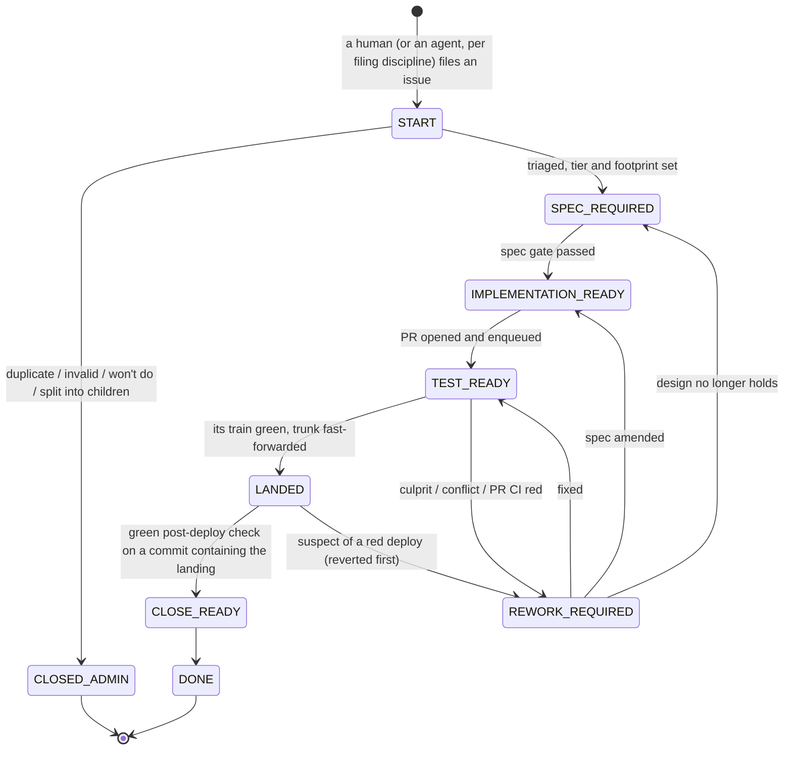

# Issue state model for the software factory: discussion notes (2026-11-09)

> Record from the factory state-model design discussion (2026-11-09 to 2026-11-11), copied from the working notes. Paths to working files were rewritten to this folder; the text is otherwise as written. Where it differs from `docs/design/factory-state-model/decisions.md`, that file wins.

Status: design discussion only. Nothing in the framework has been changed. Inputs: the user's proposed
states (chat, 2026-11-09), the keynote deck (text extracted locally; the deck and its text are not in this
repository), the current framework (`clients/common/docs/delivery.md`,
`clients/claude/agents/issue-work-orchestrator.md`, `src/payload/scripts/merge_steward.py`,
`src/payload/scripts/github_wrapper.py`), and the earlier reports in `docs/reports/`. The gap-analysis
file `docs/Gap analysis_ framework vs. keynote factory.md` is empty on disk (0 bytes), so it was not used.

---

## 1. The proposal, restated

Each issue moves through queues. Every state names the next kind of work the issue needs, and any free
worker of that kind may pull it. No worker ever waits for a human, for CI or for a deploy. A human
question parks the issue, not the worker. Merging belongs to one queue owner who tests batches ("CI
sets"). Failures come back as rework that any worker can pick up. A closing pass turns each finished
issue into learnings.

That is the right direction. It matches the keynote's outermost loop ("work the backlog until it is
empty"), its tip ("let the workers coordinate on the backlog"), and the delivery redesign's
"one owner for trunk health". It also matches how the most visible public example works: OpenAI's
Symphony uses the tracker's workflow states as the agents' state machine.

## 2. What exists today (the starting point is richer than "unclaimed / in progress / closed")

| Proposed state | Exists today as | Where it lives | Gap |
|---|---|---|---|
| START | open, unassigned, no `in-progress` label | tracker | none needed |
| triage (duplicate, sanity) | `issue-housekeeping-agent` (batch triage); the intake filing gate (new filings only) | agents | not a pipeline step for every new issue |
| SPEC-REQUIRED | the first half of the orchestrator's FIX phase | **the worker's local worktree** (`.claude/specs/<slug>`), never pushed before the PR | invisible to other workers; cannot be handed over |
| INPUT-REQUIRED | (a) ambiguous issue: a comment, then the claim is released, with no label; (b) `AWAITING_USER` in the run's local `resume_state.md`, then the session ends `NEEDS YOU` | comment / **machine-local file** | nothing machine-readable on the issue; another worker can select it again and only finds the question by reading comments |
| IMPLEMENTATION-READY | does not exist: spec and implementation are one claim by one session | — | the decoupling the proposal wants |
| TEST-READY | PR label `queue` + `Phase: QUEUED`; the merge steward | tracker + steward | the session still waits for the landing (decision A2, 2026-11-02) |
| REWORK-REQUIRED | `needs-rework` (+ `queue-failed`, `queue-conflict`, `verification-failed`) | tracker | already exists, picked first by SELECT |
| *(missing in the proposal)* deployed, awaiting verification | `awaiting-verification`, the verdict watcher, verification by ancestry | tracker + deploy pipeline | the proposal jumps from merged to CLOSE-READY |
| CLOSE-READY | `needs-closeout` (checklist unfinished after verification); `/close-session` audit | tracker / session | session-scoped, not issue-scoped |

So the delivery half of the proposal is already built. What is missing is the front half (triage,
spec, questions) as tracker states, and a hand-off between them that another worker can pick up.

Two facts from the code that the design must handle:

1. **The merge steward already isolates the culprit.** Train k = the batch base + the batch's first k
   PRs. The steward lands the longest green prefix and blames only the newest PR of the first red train.
   The PRs behind it stay queued and are rebuilt (`merge_steward.py` docstring, "ONE TICK" step 2).
   The proposal's "the issues of the CI batch are returned to REWORK-REQUIRED" would be a step back to
   blame-all, which is exactly what produced 36 `needs-rework` labels and 7 "not ours" rework sessions
   in chess (red-pipeline report, 2026-11-02).
2. **Claims are not safe across machines.** `start_issue` aborts only if the issue is "assigned to a
   different user" (`github_wrapper.py`, the `start_issue` comment). Every worker on every machine runs
   under the same account, so two machines can both claim the same issue successfully. Only the `mkdir`
   lock (`.locks/issue-<N>.lock`) serializes workers, and it works only inside one clone. With "an
   arbitrary number of workers", this is the first thing to fix.

## 3. Structural recommendations

### R1. Separate three dimensions: stage, claim, blockers

The proposal mixes them. SPEC-REQUIRED, IMPLEMENTATION-READY and TEST-READY are *stages*: where the
issue is in its life. INPUT-REQUIRED is a *blocker*: why it cannot move right now. Being worked on is a
*claim*. Model them separately:

- **stage**: exactly one per open issue (the queue it sits in).
- **claim**: at most one per issue, a lease held by a named worker, which expires.
- **blockers**: zero or more flags: `needs-input`, `blocked-by #N`, `hold`.

Why INPUT-REQUIRED works better as a flag than as a stage:

- **No "return address" problem.** With a stage you have to record where to go back to. The proposal
  already shows this ("moved forward to the appropriate step, e.g. IMPLEMENTATION-READY or back to
  SPEC-REQUIRED or…"). With a flag the stage never changed, so the issue just becomes pullable again.
- **Questions come up in every stage**, not only during spec: an ambiguous merge conflict, a required
  PR approval (four-eyes in a bank), a deploy permission (chess #1494 needed an IAM grant), a retro
  finding that needs a decision. A flag works in every stage. A stage would need a "where from" for
  each case.
- **Kanban practice** shows "blocked" as a marker on the card, not as a column, for the same reason.
- **The human still gets the inbox:** "every open issue with `needs-input`" is one query or board view.

The flag releases the claim, so no worker is blocked. This also fixes a weakness of Symphony, whose
"blocked" map lives only in the orchestrator's memory and is lost on restart.

### R2. States are durable checkpoints, not compulsory hand-offs

Every hand-off to a different worker costs a full re-read of context (issue, spec, code), in tokens and
in time. If the state model forces a hand-off at every boundary, an S-tier one-line fix pays for four
context loads. That breaks the keynote's own rule: "a one-line fix stays a one-line fix".

So: a worker that holds the claim *may* carry the issue through several stages in one claim. It records
each transition (with evidence) as it passes, so a crash at any point leaves a checkpoint another worker
can resume from. Rules of thumb:

- Tier S: START → (triage, `change.md`, test, implement) → TEST-READY in one claim.
- Tier M: hand off after the spec only if no worker is free to continue. Prefer affinity (the same
  worker goes on while its context is warm), but never wait for it.
- Tier L, or risk-tagged work: SPEC-REQUIRED → IMPLEMENTATION-READY is a real gate (see R3 and D2).

### R3. Every transition has an executable finish line, checked by someone other than the maker

This is the keynote's "every loop needs a provable finish line" and "maker ≠ checker", applied to each
edge of the state machine. A transition happens only through ONE wrapper verb, e.g.
`transition <issue> --from SPEC-REQUIRED --to IMPLEMENTATION-READY --evidence <link>`. The verb:

- compare-and-sets: it refuses if the issue is not in `--from`, or if the caller does not hold the claim;
- checks the edge's preconditions mechanically (table in §5) and refuses with the reason;
- writes one machine line on the issue (`factory: stage A -> B by <worker> evidence <link>`). That line
  is the audit trail (the keynote's "evidence an auditor can read"), the metrics source (time per stage,
  bounce rate, flow efficiency), and the recovery source if labels are ever damaged.

Putting enforcement in the wrapper and in CI, not in Claude Code hooks, is also what makes this portable.
Kiro has no StopFailure event, no session cron and no cross-session messaging (delivery-redesign
decisions), but it runs the same wrapper.

The strongest single change in this area is **acceptance tests at spec time**. IMPLEMENTATION-READY then
means: the acceptance tests exist as code on the issue branch and fail for the right reason
(`red_for_right_reason.py` already exists). The implementer makes them pass and may not change them
without re-entering SPEC-REQUIRED. The spec worker writes the finish line and the implementer cannot
move it. That is "verifier before generator" from the keynote's Do's slide. Limits: these are tests
against public interfaces (internal unit tests stay with the implementer), and some changes (IaC,
refactors) need a verification plan, e.g. an expected `cdk diff` or a smoke script, instead of tests.

### R4. Artifacts that cross a hand-off must leave the worktree

Today the spec lives in the worker's local worktree until the PR. Once another worker, possibly on
another machine or another client, does the implementation, the spec has to be on the remote. Options:

| Option | For | Against |
|---|---|---|
| **(a) pushed issue branch + draft PR** (recommended) | the implementer continues on the same branch; the draft PR is the natural place for a human to review the spec; one PR carries spec, tests and code together; no trunk churn | none worth noting; the steward already refuses drafts, so draft = not ready |
| (b) spec PR merged to trunk first | specs visible to everyone on trunk | doubles trunk merges (follow-up PRs were 40 % of chess PRs and each cancelled a trunk run); red acceptance tests cannot go to trunk without xfail markers |
| (c) spec in the issue body or a comment | readable in the tracker | size limits; no executable tests |

With (a), IMPLEMENTATION-READY pins the spec to a commit SHA (`factory: spec-approved <sha>`). A
later commit that touches the spec or the acceptance tests invalidates readiness until re-review. Post
a short AC list on the issue as well, so the human can follow the work without opening the branch.

### R5. Claims are leases with a worker identity, arbitrated by the server's order

What is needed: (1) identify the worker, not the account; (2) a race-free tie-break; (3) expiry, because
workers die. Turn deaths from API errors and client restarts were measured: 17 turn deaths and 95 h in
the wait-time analysis, plus the restarts in the stop forensics.

A protocol that works on both forges, with one shared account, on the Free tier:

1. Post a claim comment: `factory: claim <stage> worker=<host>/<session> lease-until=<ISO>`.
2. Re-read the comments. The **earliest** unexpired claim comment for that stage wins. Comment ids are
   assigned by the server and increase monotonically, so this is a total order without a lock.
3. The loser deletes its comment and pulls the next issue. The winner adds a `claimed` label as a
   cheap filter for queries.
4. The lease is extended at every checkpoint (edit the comment). A reaper releases expired leases. A
   worker that finds its lease gone or the stage changed (a human closed the issue or set `hold`)
   stops at its next checkpoint. Symphony does the same reconciliation: it stops an agent whose issue
   moved to a terminal state.

Separate bot accounts per worker would also work, but cost seats and credentials management for no
gain over (2).

### R6. Coordinate through state, not through conversation

"The workers that pick these up then need to coordinate through the backlog to resolve conflicts" is the
riskiest sentence in the proposal. Several LLM workers negotiating in issue comments gives you chatter,
deadlocks, and two workers fixing the same thing. Instead, coordinate the way the stigmergy pattern does:

- **One writer per issue at a time** (the claim).
- **Attribution is mechanical, not deliberated.** Cumulative trains attribute a failure to the first red
  prefix. Interaction failures (A green alone, B green alone, A+B red) fall to B automatically, because
  B is the one that comes later in queue order. B reworks on a trunk that already contains A. Nobody
  needs to talk.
- **Cross-issue decisions need a group claim.** "Move a batch of issues back to SPEC-REQUIRED" means one
  worker claims all affected issues, all or nothing (and releases them all if one claim fails), or it
  files one coordinating issue that blocks the others (`blocked-by`). A worker never changes the stage
  of an issue it does not hold.
- **Infra failures are not change failures.** No runner, a cancel, a timeout or a flaky test changes no
  issue's stage. The steward retries once already. Repeated infra failure belongs to the queue owner
  and is reported on the `delivery-status` issue, not on the issues.

## 4. Gaps in the proposed flow

1. **Nothing between "merged" and CLOSE-READY.** The 50-hour red streak in chess happened in deploy and
   post-deploy verification, after the merge. A LANDED state (today `awaiting-verification`) is needed,
   owned by the verdict watcher, with verification by ancestry (already built).
2. **No post-merge failure path.** REWORK-REQUIRED in the proposal is pre-merge. After a landing, the code
   is on trunk: the issue cannot simply "go back". The red-pipeline report's F1 (revert first, on a
   clock, by the queue owner) is required for "no single issue blocks everything": revert the suspect
   landing, then REWORK-REQUIRED with "reverted in <sha>". The rework PR then carries the original change
   plus the fix. This decision is still open (red-pipeline report, options F1–F6).
3. **Triage outcomes other than "go on".** Duplicate, invalid, won't-do and already-fixed need an
   administrative close (already defined in `issue-tracking.md`). Too large needs a split: the children
   start at START and the parent becomes a tracker whose stage is derived from its children.
4. **Admission control.** If any new issue is picked up automatically, an issue body is an instruction
   to an agent with repository write access. On anything but a private single-user repo, only issues
   from trusted authors (or carrying an admission label a trusted human sets) may enter START. Symphony's
   `required_labels` exists for exactly this. Agent-filed issues (the keynote's feedback loop) may enter,
   but triage applies the filing discipline again (observed defect, named incident) so the factory
   cannot feed itself without limit.
5. **The human changes the issue after the spec.** If the issue body changes after `spec-approved`, the
   readiness no longer matches the ask. Record a hash of the body at approval; a mismatch sends the
   issue back to SPEC-REQUIRED at the next checkpoint. Alternative: freeze the body after approval and
   treat later changes as comments or new issues.
6. **Spec rot.** Specs written far ahead of implementation go stale as trunk moves. Use a WIP limit on
   IMPLEMENTATION-READY (e.g. no more than about 2× the implementer count); spec workers that hit it pull
   triage or retro work instead. At pickup, check: if the spec's footprint files changed on trunk since
   the spec's base, do a delta re-review first.
7. **Loops without an exit.** An issue can bounce REWORK ↔ TEST-READY (a flaky suite) or SPEC ↔
   INPUT-REQUIRED (an agent that keeps asking). Each issue needs counters and a budget (rounds per stage,
   tokens or time). The keynote: "every unattended loop gets a budget". Crossing the limit sets
   `needs-input` with a short "stuck because …" summary.
8. **Telling human comments from agent comments.** All workers post as the user's account. The liaison
   agent has to recognise human answers: every agent comment carries a machine marker (e.g. a hidden
   `<!-- factory -->` footer), and anything without the marker is the human's.
9. **Human gates the proposal does not name.** A PR approval, if the project requires one
   (`require_approval` exists in the steward config), and a spec approval for high-risk work. Both are
   `needs-input` flags of kind "approval" on the current stage.
10. **Shared environments.** "Can the agent run the thing?" during implementation needs an environment.
    If that is the shared dev account, implementers queue for it again, which is the race the proposal
    wants to remove. Use per-issue ephemeral environments where possible (local emulation, per-issue
    stacks with a TTL in a sandbox account). Otherwise the environment is a leased resource that only the
    queue owner or deployer holds, never an implementer who waits on it.
11. **Pull priority.** With many queues, which one does a free worker pull from? Kanban: from the right.
    That gives REWORK-REQUIRED > CLOSE-READY > IMPLEMENTATION-READY > SPEC-REQUIRED > START, then
    priority within each queue. Within a stage, prefer issues whose declared footprint does not overlap
    work in flight (the steward already does this inside a batch; the spec can declare the footprint).
12. **CLOSE-READY must not hold delivered work open** (see D4), and its output must follow the
    filing discipline: observed defects only, zero issues is a fine result. It must also not create
    follow-up PRs on trunk; the reason is the same 40 % follow-up-PR measurement as in R4.

## 5. A refined model

> Partly superseded by §11: LANDED is folded into TEST-READY (§11.5), and there are no human gates (§11.4).

```
START ─triage─► SPEC-REQUIRED ─spec gate─► IMPLEMENTATION-READY ─PR─► TEST-READY ─train green─► LANDED ─deploy check green─► CLOSE-READY ─► DONE
  │  (tier S: one claim may run START ──────────────────────────────►┘)   │                          │
  └─► CLOSED-ADMIN (duplicate / invalid / won't do / split)                └─► REWORK-REQUIRED ◄───────┘
                                                                               (culprit only; after a landing: revert first)
                                                                               └─► TEST-READY | IMPLEMENTATION-READY | SPEC-REQUIRED

Orthogonal on every open stage: claim (lease) · needs-input (= INPUT-REQUIRED) · blocked-by #N · hold · tier + risk tags · attempt/budget counters
```



| Stage | Pulled by | Exit criteria (checked by the transition verb; checker ≠ maker) |
|---|---|---|
| START | triage worker | duplicate search done; sanity ("does this belong here?"); tier S/M/L and risk tags set; directional questions asked in ONE batch with recommended answers; footprint estimated |
| SPEC-REQUIRED | spec worker (Kiro's native spec flow fits here) | spec on the pushed issue branch at a pinned SHA; every AC mapped to a test; acceptance tests committed and red for the right reason; footprint declared; review panel verdict (not the author); no blocking question; human approval if the policy requires it (D2) |
| IMPLEMENTATION-READY | implementer | every AC test green; acceptance tests unchanged since the spec SHA; adversarial verifier pass; evidence report; PR opened, `Refs #N`, enqueued (`--allow-pending` lets it hand off before PR CI finishes) |
| TEST-READY | merge steward only (not claimable) | landed → LANDED; first-red-prefix culprit or conflict → REWORK-REQUIRED; everyone else stays queued |
| LANDED | verdict watcher only (not claimable) | green post-deploy check by ancestry → CLOSE-READY; suspect of a red streak → revert (queue owner) → REWORK-REQUIRED |
| REWORK-REQUIRED | implementer, pulled first | the entry comment carries the machine-readable cause (conflict / train job + log / deploy red + revert sha / review finding); exit as above |
| CLOSE-READY | retro worker | retro done: issues filed (filing discipline), steering or skill updates proposed, digest lines for the human |

What the human does, and nothing else: file an issue (no labels needed: no stage label means START),
answer questions and approvals in the inbox, set `hold` or close to stop something, and set priorities.

### The question lifecycle (INPUT-REQUIRED done as a flag)

- Every question is one record on the issue, in the existing five-line shape: `Q-n`, blocking or not,
  context line, two to four options with consequences, the recommended option first.
- **Non-blocking** (a reversible decision): the worker goes on with the recommended option, records it
  as an assumption, and the issue does not stop. The human can override later; an override after the
  spec becomes REWORK-REQUIRED or SPEC-REQUIRED, and after the landing a new issue.
- **Blocking** (irreversible, or the ask is genuinely ambiguous): set `needs-input`, release the claim,
  and pull the next issue.
- **The inbox session** (the "separate agent" of the proposal): the human starts it when they have
  time. It collects `needs-input` across issues (and across projects, which helps with several
  projects), removes duplicates, groups by theme, asks in priority order, posts each answer verbatim
  on its issue, and clears the flag.
- **Fewer questions over time.** An answer that is a general rule ("we always use expand–contract for
  migrations") becomes a decision record or a steering line, so the next issue does not ask again.
  This is the keynote's "every correction you make twice goes into a steering file".

## 6. Why this removes the "waiting for a quiet CI or deploy slot" race

The race came from workers owning the post-PR part of the delivery: each waited for its own CI, its own
landing and its own deploy (66.5 % of session span was waiting; post-merge was 49 % of the span). In the
model, every kind of wait has one owner and no worker sits in it:

| Wait for | Owner | The worker meanwhile |
|---|---|---|
| a human | `needs-input` + the inbox | pulls the next issue |
| PR CI | the steward (`--allow-pending`) or a short bounded wait | pulls the next issue |
| merge | the steward | pulls the next issue |
| deploy + verification | the verdict watcher | pulls the next issue |
| a shared environment | the queue owner (lease) or an ephemeral environment | never waits on it |
| another worker | nobody: claims + footprint scheduling avoid overlap | pulls a non-overlapping issue |

Decision A2 (2026-11-02, "the session owns the issue until it LANDS") was taken because hand-offs
stranded: 0 of 10 closed. They stranded because no one picked up returned work; the only workers were
sessions a human had started. The model reverses A2 safely only together with a **dispatcher** that
guarantees a worker for every non-empty queue. The dispatcher has to poll, since webhooks cannot reach
a laptop (webhook report, 2026-11-06). Kiro Crew's cron or heartbeat crews are a natural host for it.

Trade-off in batching. Cumulative trains run n CI jobs per batch in parallel: fast, with exact blame,
but expensive in minutes. A single batch run with bisection on failure (Mergify, the GitHub merge
queue's bisection mode, shunt) is cheap when green and slower when red. With a low failure rate,
batch + bisect is cheaper. With a high one, trains are faster. This could be a steward setting.

## 7. What it would change in the framework (for later, not now)

- The unit of work changes from "a session owns an issue end to end" to "(issue, stage), claimed by
  any worker". Machine-local run state (`resume_state.md`, `workflow_state.md`, the registry, the
  `mkdir` lock) can no longer be the source of truth for anything another worker needs. The tracker and
  the pushed branch must be.
- The Stop-side gates (`spec-stop-gate`, the issue-loop brake, `session-verdict`) are session-centric
  today. In the model, a worker's turn ends correctly when its claim ends in a valid transition, a
  `needs-input`, or a release.
- New: the `transition` verb and the state table in the wrapper (both forges), the claim protocol, a
  reaper for leases, a dispatcher, an inbox command, a triage role, and a retro role.
- Unchanged and reused: the merge steward (TEST-READY), the verdict watcher (LANDED), the review panel
  and the tier rules (SPEC), the TDD and evidence gates (IMPLEMENTATION), and the filing discipline (retro).

Where the state is stored on the tracker:

- **Plain labels with a prefix** (`stage:spec`) work on every tier of both forges, and the transition
  verb enforces exclusivity. Recommended as the one portable code path.
- **GitLab scoped labels** (`stage::spec`) are natively mutually exclusive, but need Premium or
  Ultimate. The tier of `the corporate GitLab instance` is unknown.
- **GitHub issue fields** (organization-level single-select, GA since July 2026 on all plans per
  GitHub's announcement) fire `issues` webhook events (`field_added`/`field_removed`). They are a
  possible later upgrade for orgs, but are not available for user-owned repositories.

## 8. Decisions for the user

- **D1. INPUT-REQUIRED as a flag on the current stage, or as its own stage.** DECIDED 2026-11-09: a
  flag (`needs-input`), read and answered through a separate command (§10).
- **D2. Human approval of specs: for which work?** AI-DLC as quoted in the keynote's backup slide:
  "implements only after a human validates". Recommended: a policy knob. Off for S; off or optional for
  M; on for L and for risk tags (auth, money movement, data migration, IAM/IaC). For a bank, "on" for M too.
- **D3. Where the spec lives between workers.** Recommended: the pushed issue branch plus a draft PR (R4).
- **D4. CLOSE-READY: before or after the close.**
  - (a) Recommended: close the issue at verification, then run the retro on the closed issue
    (`retro-pending`). Delivered work then looks delivered, and the empty-backlog signal stays honest.
  - (b) Keep the issue open until the retro is done. Retro latency then counts as delivery time, and a
    retro question holds a finished issue open.
  - Either way: the retro is mandatory for M/L and batched for S, for cost.
- **D5. Revert first after a red deploy (F1 of the red-pipeline report).** The model needs some
  post-merge path; this one is still undecided.
- **D6. Claim protocol.** Recommended: claim comments under one account with server-ordered tie-break
  and leases (R5). Alternative: a bot account per worker.
- **D7. Admission.** Who may put an issue into START without a human admitting it: only you? any
  collaborator? agent-filed issues?
- **D8. Non-blocking questions.** May a worker go on with the recommended option for reversible
  decisions, and is it then up to you to override?

## 9. Decisions taken (2026-11-09)

1. **INPUT-REQUIRED is a flag** (`needs-input`) on the current stage, not a stage. Setting it releases the
   claim. A separate command gives the human access to all open items (§10).
2. **Pre-merge failure attribution uses the merge steward's cumulative trains**, not a whole-batch return.
   What enters REWORK-REQUIRED from TEST-READY:
   - a red train: only the newest PR of the first red prefix, after one retry if it never failed before
     (`retry_culprit_once`); the PRs ahead of it land, the PRs behind it stay queued and are rebuilt;
   - a merge conflict while building a train: only the PR that conflicts (`queue-conflict`);
   - red PR CI, a draft, a closing keyword, a dependency closed unlanded: only that PR;
   - no CI result (no run, cancel, timeout): no blame on the first occurrence (retried), the culprit rule
     on the second.

   Consequence for interaction failures (A green alone, B green alone, A+B red): B is returned and
   reworks against a trunk that already contains A. If B's worker concludes that A itself is wrong,
   it does not move A. It adapts B to the trunk as it is, and A's defect becomes a new issue (or A is
   reopened) through the filing discipline.

   Still open on the post-merge side: the verdict watcher's attribution is coarser than the steward's.
   On a red deploy, every issue that landed since the last green deploy and is contained in the red one
   is a suspect (`delivery.md` §4). A deploy cannot be bisected as cheaply as a CI train. That is why
   D5 (revert first) is the remaining piece of the rework mechanism.

## 10. The guidance command (sketch)

Name. Claude Code command names say what the agent does when you type them (`/work-issue`,
`/close-session`). `/get-guidance` follows that convention: the agent gets guidance from you. It also
covers more than questions: approvals, permission grants (chess #1494's IAM action) and "stuck"
reports. `/answer-open-questions` reads from the human's side and undersells the approvals.
Recommended: `/get-guidance`, with the same prompt on Kiro.

What it does:

1. **Collect.** It runs on the project (later: across several projects from one list). It gathers every
   open issue with `needs-input`, and every question record on it that has no answer line yet.
   Sections, in order: blocking questions and approvals; "stuck" reports from the circuit breaker;
   non-blocking assumptions you may override (FYI, lowest priority).
2. **Order and dedupe.** Blocking items first, then by issue priority, then by age. Items that ask the
   same decision across several issues are asked ONCE, and the answer is applied to all of them.
3. **Ask.** One item at a time, or a small batch, in the five-line shape (context, two to four options
   with consequences, the recommended option first). In Claude Code: the multiple-choice question UI,
   always with free text. In Kiro: plain chat. "Skip" is always allowed; a skipped item stays flagged.
4. **Record.** Post your answer verbatim on each affected issue, with a machine line
   (`factory: answer Q-<n> = <option> (by <you>)`) that workers and the dispatcher read. Clear
   `needs-input` only when no blocking question on that issue is left.
5. **Consequences.** The command does no implementation work. If an answer clearly sends the issue to
   another stage (for example "drop requirement 3", which invalidates an approved spec), it performs that
   one transition through the transition verb. Otherwise the stage stays, and the next worker in that
   stage reads the answer and decides. Since a flagged issue holds no claim, the command never races a
   worker.
6. **Learn.** When an answer is a general rule ("always expand–contract for schema changes"), it offers
   to record it as a decision record or a steering line, with your approval, so later issues do not ask
   again. This is how the number of questions goes down over time.
7. **End.** A fixed summary: answered, skipped, still open, and issues unblocked. It can be stopped at
   any point: all state is on the issues, so the next run resumes where this one stopped.

The command is a guided walk through the backlog, not the only channel. An answer written directly on
the issue in the tracker UI must work as well: a comment without the agent marker, after an open
question, counts as your answer. The command recognises it and does not ask that question again.

## 11. Round 2 decisions and corrections (2026-11-09)

1. **Revert first** is the default when a deployment fails or the deployed code fails the smoke test.
   The revert must minimise the time the solution is non-functional (research: §14).
2. **Maker ≠ checker everywhere.** Every state has a team: makers, plus dedicated checker agents and
   deterministic tools. They exchange structured records, not prose. The records also travel through
   issue comments or repository mechanisms when the two sides work on different issues or machines
   (§15).
3. **Loop principle.** Every state has a deterministically checkable goal. The team loops until it
   holds. Only when the agents have demonstrably tried and failed does the issue get `needs-input` (§12, §13).
4. **No human-only states or gates.** Everything must work without human intervention. The human is
   the conflict-resolution mechanism of last resort, reached only through `needs-input`. This settles
   D2: no human approval of specs by default.
5. **TEST-READY spans queue → merge → CI → deploy → smoke.** There is no separate LANDED state; the
   hand-offs inside it (steward → deploy pipeline → verdict watcher) are machine lines on the issue, not
   states. CLOSE-READY starts when the pipeline including deployment and smoke tests is green on a
   commit that contains the issue's landing.
6. **No WIP cap on IMPLEMENTATION-READY.** Workers prefer IMPLEMENTATION-READY issues. When CI is red, or
   nothing is ready for implementation, writing specs beats idling.
7. **Shared environments, no throwaway environments.** Incoming changes are batched: one CI or deploy
   run covers many issues, never one wait per issue.
8. **Agent comments vs human comments** are told apart by an inline marker (e.g. "The question was
   answered by <user>: …"); the details are up to the design.
9. **Budgets and bounce counters:** a proposal derived from measured data across the projects; crossing
   one escalates, and that must be the absolute exception (§17).

## 12. Exit predicates per state (the loop's finish lines)

Design rule: a predicate is evaluated by a script (the transition verb), from tracker + git + CI state
only. Judgement still happens, but inside the checkers. The predicate only counts their structured
verdicts, which makes it deterministic:

> **"Every checker required for this state (by tier and risk tags) has posted a verdict on the
> artifact's current SHA, and no blocking finding is open."**

A verdict on an older SHA does not count. A new commit by the maker re-opens the check, so the checker
re-verifies (delta review only).

| Transition | Deterministic predicate |
|---|---|
| START → SPEC-REQUIRED | a triage record exists for the current hash of the ask, with: duplicate search done (candidates listed, verdict), scope verdict, tier, risk tags, estimated footprint; no open blocking question |
| START → closed (duplicate / won't do / invalid) or split | the triage record's outcome + a SECOND agent's confirming verdict (closing is the one triage outcome that destroys work, so it gets a checker); for a split: every child exists at START and references the parent |
| SPEC-REQUIRED → IMPLEMENTATION-READY | spec + acceptance tests committed at SHA S on the pushed issue branch; the acceptance tests fail for the right reason at S (`red_for_right_reason`); every `AC-n` is referenced by ≥ 1 test (traceability script); all required spec checkers report on S with 0 open blocking findings; no open blocking question; a `spec-approved` record `{sha: S, ask_hash, last_human_comment_id}` is written |
| IMPLEMENTATION-READY → TEST-READY | PR from the branch with `Refs #N`, not draft, base = trunk; the acceptance tests are unchanged since S (`git diff S..HEAD -- <acceptance paths>` is empty) or a newer `spec-approved` covers them; PR CI green on head H, incl. every AC test; all required implementation checkers report on H with 0 open blocking findings; evidence report present; the steward accepts the PR (`check-pr` 0, or `--allow-pending`) |
| TEST-READY → CLOSE-READY | the steward's landing line exists, AND a deploy + smoke run concluded green on a commit D with the landing an ancestor of D, AND every `(post-deploy)` item is ticked (the user's example; the verdict watcher already evaluates exactly this) |
| TEST-READY → REWORK-REQUIRED | a steward record names this PR as culprit / conflict / PR-CI-red, OR a revert record after a failed deploy or smoke names this issue as the culprit |
| REWORK-REQUIRED → TEST-READY | the IMPLEMENTATION-READY → TEST-READY predicate on the new head, plus a resolution record that answers the rework cause (e.g. the job that failed is green on the new head) |
| REWORK-REQUIRED → IMPLEMENTATION-READY / SPEC-REQUIRED | a rework-analysis record (cause, what must change); the target state's own predicates then apply from scratch |
| CLOSE-READY → closed | a retro record in which every laundry-list item has a disposition (filed #M / steering change proposed / flagged in the digest / nothing to do); checklist complete; no open PR references the issue; the remote branch is gone |

Two pickup preconditions (checked when a worker claims, not as transitions):

- **Ask unchanged since approval.** At an IMPLEMENTATION-READY pickup, the verb compares `ask_hash` and
  `last_human_comment_id` with the issue now. A mismatch sends the issue back to SPEC-REQUIRED; if
  the change turns out immaterial, the spec checkers re-approve quickly. The hash covers title and body
  WITHOUT checklist tick states, because ticking a checkbox edits the body.
- **Spec base current enough.** If the files of the spec's footprint changed on trunk since S, the spec
  checkers do a delta review against the new trunk first. This replaces the WIP cap the user rejected.

One consequence for CLOSE-READY: dead-code and "unnecessary code" checks belong to the IMPLEMENTATION
team, before the PR, so the landed change is already clean. A clean-up PR after the landing would be the
follow-up-PR pattern that measurably cost trunk runs (40 % of chess PRs). CLOSE-READY then produces
records, issues and steering proposals, but no trunk commits.

## 13. The team loop inside a state

```
claim (lease) ──► maker produces / updates the artifact at SHA X
   ▲                    │
   │                    ▼
   │        deterministic tools on X (cheap; SARIF out) ──► findings
   │        LLM checkers on X, in parallel, given the tool output ──► findings
   │                    │
   │        predicate(X) true? ── yes ──► transition (verb) ──► release or continue to the next state
   │                    │ no
   │                    ▼
   │        maker answers EVERY open finding: fixed@SHA / alternative / disputed (with evidence)
   │        conflicting findings (A's fix violates B's rule) ──► joint round: maker proposes one change,
   │            every affected checker must accept it on the new SHA
   │                    │
   └── budget left? ────┘ no ──► needs-input with the structured summary (the rare exception)
```

- A checker verifies only ITS OWN findings on the new SHA (delta review), plus any new code the fix
  introduced.
- A dispute is resolved first between maker and checker with evidence. A finding the maker has
  disputed twice without an agreement counts as a conflict.
- Several makers can work in one state at once (e.g. implementation waves with file ownership, which
  already exist); the checkers then review the integrated SHA.

## 14. Revert first with minimal red time (research: `revert-and-batching.md`)

**"Red" is three clocks, with different cures:**

| Clock | Meaning | Chess, 2026-10-31..11-02 | Cure |
|---|---|---|---|
| NFT, non-functional time | dev cannot serve | probably small: CloudFormation had rolled the failing stack back | environment restore (Track E) |
| VBT, verification-blocked time | no deploy containing the culprit goes green, so no innocent issue is verified | most of the 50 h | fast, correct trunk revert (Track T) |
| TBT, trunk-blocked time | landings are paused | — | never pause; keep batches small while red |

**Why a naive revert costs an hour or more.** Chess's deploy job took a median of 94 min. Almost all of
that is build and re-synthesis, which a restore does not need. The restore redeploys only the stacks whose
template changed, from the cached last-green cloud assembly. `cdk deploy --app <dir>` skips synthesis, and
`cdk gc --rollback-buffer-days` keeps the assets.

**Track E: environment restore** (the deploy job; needs no attribution):

1. **Pre-flight**, seconds: IAM simulation of the action manifest, export-in-use check, change-set
   validation.
2. **Deploy**, with a result per stack.
3. **Smoke**, retried once.
4. **On failure, auto-restore** the changed stacks from the last-green assembly, consumers before
   producers, inside the SAME run. A separately dispatched restore could be superseded by a pending deploy.
5. **Smoke again.** If last-good is also red, it is infra, and nobody is blamed: this is the
   "passes without" test for free.

**Track T: trunk revert** (the steward; needs attribution):

1. Classify infra first.
2. Attribute deterministically where possible: diff the failing stack's synthesized template across the
   batch's cumulative states, which the steward's trains already are. The first step that changes the
   failing resource or export is the culprit. Smoke failures fall back to a heuristic ranking.
3. Revert with `git revert -m 1 <merge>` as **train 1 of the next batch**. Landings are never paused; while
   red, batches are capped small.

**Issue reactions** (translated to §11.5, where TEST-READY spans everything up to the green smoke):

| Role in the red window | What happens |
|---|---|
| **culprit** | → REWORK-REQUIRED with a `reverted <landing> in <sha>` record. The rework branch starts with a revert of the revert, because git re-merges nothing after a reverted merge otherwise. |
| **innocent** | stays in TEST-READY; the next green deploy verifies it by ancestry; no rework, no re-landing. |
| **ambiguous suspects** | all reverted, stay in TEST-READY, and the steward relands them itself in bisection order; no worker is involved. |
| **grant needed** (IAM) | culprit + `needs-input`; you are asked only for the grant. |
| **infra** | no issue changes; the delivery-status issue records it. |

**What each project must provide:**

| Tier | The project provides | NFT on a smoke failure |
|---|---|---|
| Minimum | cached assemblies + a restore hook in the deploy script; CloudFormation rollback on; ECS circuit breaker; custom-resource timeouts; an IAM action manifest | est. 5–30 min |
| Better | stateful stacks split out with stack policies; smoke as pre-traffic hooks (traffic never reaches the broken version); expand–contract migrations | ≈ 0 for hooked components |
| Best | blue/green with bake time everywhere; feature flags | seconds |

**Replay of chess #566.** About 2.5 h red instead of about 44 h after the cause was known. The
export-in-use pre-flight check would have rejected it in the train: 0 h.

**Hazards in today's code that revert-first triggers.** These must be fixed together with it.

- **H1.** The verdict closes a reverted culprit's issue on the next green deploy: the landing commit stays
  an ancestor (verified in `merge_steward.py` 1764–1787). A `reverted` line must supersede the landing.
- **H2.** Re-merge after a reverted merge (revert-of-revert).
- **H3.** A restore must not count as a trunk verdict.
- **H4.** Supersession of a separate restore run.
- **H5.** The revert itself may be undeployable.
- **H6.** Serial stack masking.

Not fixable by a faster revert: a failed rollback (`UPDATE_ROLLBACK_FAILED`), irreversible migrations, and
stateful resource replacement. These need prevention checks in the train and an owner.

## 15. The maker/checker exchange (research: `review-protocol.md`)

**`factory-review/v1`.** One JSON envelope (actor, issue/PR/commit/stage/iteration, addressee) carries
seven append-only record types: `finding`, `resolution`, `verification`, `link`, `proposal`, `decision`,
`verdict`.

- **Finding.** A finding IS a SARIF 2.1.0 result (a subset). The framework's fields go under `factory/…`
  property keys: severity A–D, blocking, material-because (an AC/UB id or a failure class), standard,
  reasoning, evidence, options with patches. A finding can therefore be exported to SARIF unchanged.
- **Target.** The reviewer writes meaning, a tool computes coordinates. The reviewer gives a quote (a W3C
  `TextQuoteSelector`: exact text plus prefix and suffix) and a symbol or section. The tool resolves line,
  offset and fingerprint at the pinned SHA, and rejects quotes it cannot find. The same mechanism works for
  code and for spec prose, and it removes invented line numbers.
- **Status.** Never stored. It is derived by folding the records in the server's comment order:
  open → addressed → verified | disputed → escalated | withdrawn | wont-fix-accepted.

**Transport.** The same bytes travel three ways:

1. **Inside one machine:** a file per lane per iteration.
2. **Between machines and issues:** an issue comment. It has a hidden marker line, a one-line
   Conventional-Comments rendering for humans, and the JSON in a fenced block inside `<details>`. Rules: at
   most 60,000 characters (GitHub's limit is 65,536), deterministic ids, read before write, never edit.
   Labels `review-open` and `review-verify` are the cheap index of "work addressed to me".
3. **As PR/MR projections:** review threads, plus a `factory/review` commit status. That status is the
   authoritative gate. A personal token can set it on both forges, whereas check runs need a GitHub App and
   SARIF ingestion needs a paid tier.

The marker also tells agent comments from human ones.

**Loop: one maker, N checkers.**

1. Each checker verifies only its own findings at the new SHA, with re-run evidence. A "verified" without
   fresh evidence is invalid, which counters false consensus.
2. Conflicts are detected mechanically (overlapping anchors with different fixes, a regression caused by
   another lane's fix, oscillating fingerprints) or declared by the maker.
3. For a conflict set, the maker posts a proposal saying for every finding how its rule is met. Every
   affected checker must accept with evidence. A rejection must carry a counter-option that satisfies all
   of the findings.
4. After 2 rounds, a fresh arbiter decides: facts first, then a standards precedence, by default security
   > data loss > ACs and correctness > operability > maintainability > style.
5. Only a genuine product decision, an irreversible or sensitive choice, or an exhausted budget reaches
   the human, as one five-line question.

The literature backs the low round cap. Most of the gain of multi-agent debate comes from the first
independent answers (NeurIPS 2025). Reviewer–critic loops drift into false agreement unless disagreement
is made explicit (2026).

## 16. The team per state (research: `checker-landscape.md` §3)

| State | Makers | Checkers, deterministic first, then LLM (tier and risk-tag gated) |
|---|---|---|
| START | triage worker | duplicate retrieval; risk-tag and footprint heuristics; **duplicate-confirmer** (a second agent, mandatory before any close) |
| SPEC-REQUIRED | spec-author (+ researcher); acceptance-test author | AC→test traceability; red-for-right-reason; EARS/INCOSE spec lint (new); test-architect (every); security-reviewer (one-line CLEAN unless a trust boundary is touched); **threat-model lane** (new: STRIDE + ASVS 5.0, L or risk tags); devops-iac-reviewer (IaC); standards / best-practice (M+) |
| IMPLEMENTATION-READY | spec-implementer (waves), ci-workflow-agent, code-merge-reviewer | ruff, mypy, bandit, secrets, tests; **diff-coverage on changed lines** (new); **OSV-Scanner** (new); **IaC gate: cdk-nag + cfn-lint + Checkov + `cdk diff --security-only`** (new); import contracts; mutation on changed functions (L or risk tags); **dead/unnecessary code on the diff** (vulture or Skylos `--diff`, knip); adversarial-verifier (every); **logic-bug reviewer** (new, M+); security and devops lanes by risk tag |
| TEST-READY | merge steward, deploy pipeline | train CI; change-set replacement/deletion detector for stateful resources (new); drift-aware change-set preview; pre-flight (Track E); smoke/E2E; failure attributor |
| REWORK-REQUIRED | any implementer | only the lanes with open findings, plus lanes whose files the fix touched (delta), scoped by the previous SARIF baseline |
| CLOSE-READY | cleanup worker, retro writer | retro checker (every learning backed by evidence, nothing filed without an observed defect); docs drift; leftovers on the diff (TODO/debug flags) |

Findings from the landscape:

- The framework's checkers today are all LLM lanes. The deterministic set is Python-only and emits no SARIF.
  Missing are dependency scanning, an IaC scanner, a diff-coverage gate and mutation testing.
- Two existing agents violate maker ≠ checker: `issue-housekeeping-agent` and `doc-reviewer-agent` both
  make and check.
- Useful external agents, optional and always budget-capped, never the only checker for a gate:
  - AWS DevOps Agent release readiness (preview, GitHub + GitLab);
  - AWS Security Agent: design review, PR review, pen test at $50 per task-hour.
- Pin every scanner by SHA or digest: the Trivy and KICS GitHub Actions were compromised in 2026.
- Duplicate closing needs two agents: one project's bot closed about 15,000 issues on a single LLM verdict.

## 17. Budgets and bounce counters from the data (research: `thresholds.md`)

**Data.** 600 issues claimed since 2026-10-01 on four trackers (read-only), 1,769 specs, 365 transcripts
and 566 run-state files.

**Rule.** Several counters run per issue and their trip rates add up, so each counter has two limits:

- a **soft limit** (about p90–p95) that triggers an automatic corrective step: a fresh worker, a re-tier,
  approval with residuals, or a revert;
- a **hard limit** (about p99 or above the observed maximum) that sets `needs-input` with a "stuck
  because …" record. That record names the counter, its value, the last three causes and a recommended
  option, which is how the "they must have tried" proof is made.

| Loop | Soft (automatic) | Hard (human) | Hard ≈ |
|---|---|---|---|
| S spec review | 2 → approve with residuals | 3rd pass still has an open A | > p99 |
| M / L design review | 4 / 6 → approve with residuals | open A at the cap, or no progress over 2 iterations | p90–p99 |
| SPEC ↔ needs-input | 2 → batch questions with defaults | 3rd blocking episode | p99 |
| Verifier (refute → fix) | 3 → fresh verifier + implementer; S re-tiers to M | 6th round still refuted | > p99 |
| PR CI red rounds (per PR) | 2 → classify infra vs change | 5th change-caused red | p99.75 |
| Queue returns (issue lifetime) | 2 | 4th | p99 |
| Culprit deploy failures | 1 → revert first | 2nd | > p99 |
| Total rework rounds | 2 | 4th | p99 |
| Claims without progress | 3 → a different worker next | 5th | p99.2 |
| Cost S / M / L | $300 / $1,000 / $2,500 → re-plan | $500 / $2,500 / $4,000 | soft ≈ p90, hard ≥ max (S, L), p98 (M) |
| Elapsed time | digest alarm at 48 / 96 / 168 h | none (an expired lease reclaims the issue) | — |

**Expected escalation rate from budgets: about 2–3 %, falling towards 1 % with culprit-only attribution.**
Measured for the tracker counters alone: 1.3 % pooled, 2.1 % for chess under blame-all.

**Which counters reset when:**

- per stage visit: review, verifier and question counters;
- re-entering SPEC gets half the cap, so REWORK ↔ SPEC ping-pong gets no fresh budget;
- per PR: CI rounds;
- never reset by a worker: queue returns, culprit failures, rework, claims and cost. Only a human answer
  raises the limit of the counter that tripped.

**What does not count as a bounce:** infra failures, flakes fixed by re-running the same SHA, landing into
an already-red environment, and conflicts an automatic rebase resolves.

**The bigger problem is not loops.** 38 % of the issues worked on this machine since 10-01 asked the human
something. The causes: two thirds were product or design decisions; the rest were credentials or sign-in,
manual actions and environment faults. Exhausted loops explain only 7 % of worked issues.

To make the human "the absolute exception", three things are needed besides budgets:

1. reversible decisions proceed with the recommended option (D8);
2. one owner for environment health;
3. credentials that do not expire mid-run.

Today's time tripwires (S 3 h, M 24 h, L 72 h) do not fit elapsed time: 89 % of S issues exceed 3 h, mostly
waiting. A time budget must count active time only.

## 18. Answers to the user's notes on the gaps (2026-11-09)

- **Merged → CLOSE-READY.** Agreed and adopted (§11.5).
- **Failure after the merge.** Yes, revert-first is that path. It needs Track E plus Track T (§14) and the
  H1–H6 fixes.
- **Admission control: the gap.**
  - **The concern.** The factory turns every new issue into instructions executed by an agent with write
    access to the repository and deploy credentials for AWS. Whoever can open an issue can therefore
    direct those agents.
  - **On a private repo with only you as collaborator**, two residual paths remain:
    - integrations that can open issues (bots, apps);
    - agent-filed issues whose text quotes untrusted content: log lines, web pages, error messages. The
      keynote's feedback loop, where a DevOps agent files issues from logs, is exactly that path.
  - **Proposal.**
    - Auto-admit issues by allowed authors only: you, and the factory's account with the filing gate's
      provenance lines.
    - Quote untrusted content inside agent-filed issues as data, fenced and marked.
    - The triage checker refuses an ask that originates in quoted untrusted text.
  - **Question for you:** will the factory ever run on repositories where other people can open issues?
- **Editing after IMPLEMENTATION-READY.** Yes, keep a cheap, deterministic mechanism. You talk to the
  projects only through the backlog, so editing an issue is the natural way to change your mind.
  - `spec-approved` stores a hash of the ask (title + body without checklist tick states) and the last
    human comment id.
  - The transition verb compares both at pickup and at every checkpoint. A mismatch sends the issue back to
    SPEC-REQUIRED, where the spec checkers re-approve quickly if the change is immaterial.
  - After TEST-READY the code is already in the queue or on trunk, so a change becomes a new issue.
- **Stale specs.** Adopted: no cap; IMPLEMENTATION-READY first. The pickup check stays: a delta re-review
  only if the spec's footprint changed on trunk.
- **Budgets.** §17.
- **Marker.** Adopted. `factory-review` carries the marker. An unmarked comment, after an open question,
  is the human's.
- **Human gates.** Adopted: none. A project-side rule such as required approvals in branch protection is
  outside the model and would show up as `needs-input`.
- **Shared environments.** Adopted, with batching. Deploying "the latest green trunk" already batches
  every landing since the last deploy into one run. What was missing was attribution and revert for a
  failed batch (§14).
- **CLOSE-READY clean-up scope (recommendation).**
  - Run dead-code and unnecessary-code checks in the IMPLEMENTATION team, on the diff, before the PR.
  - CLOSE-READY then cleans up without trunk commits: branches, worktrees, labels, leftovers. It writes
    the retro and files what it finds.
  - Reason: clean-up PRs after a landing are the follow-up-PR pattern that measurably cost trunk runs
    (40 % of chess PRs). They would also send the issue through TEST-READY again.

## 19. Open decisions after round 2

Recommended defaults are taken as the working baseline unless the user objects:

- **Claims.** Claim comments under one account, the server's comment order as tie-break, leases with
  expiry (D6).
- **Where the spec lives.** The pushed issue branch plus a draft PR (D3).
- **Review records.** The canonical log on the work issue; JSON in a fenced block inside `<details>`; the
  arbiter as a separate agent; the default standards precedence; SARIF upload, GitLab Code Quality export
  and HMAC signing later.
- **Revert details:**
  - while red: cap the batch size rather than pause (D-R2);
  - ambiguous windows: revert all suspects and reland by bisection (D-R3);
  - smoke retried once (D-R5);
  - a reduced check for clean reverts (D-R1): undecided, default the full train CI.

Needing the user:

- **D8. Proceed with the recommended option for reversible questions.** The data makes this the biggest
  lever for "the human as the exception": two thirds of today's escalations were decisions.
- **D7. Admission.** Will other people ever be able to open issues on factory repositories?
- **D-R6. The Minimum revert tier as a requirement for every AWS project.** The deploy-script restore hook
  plus the artifact cache, written into the setup prompt.
- **D-R4. Where cached assemblies live:** Actions or CI artifacts, or an S3 bucket in the dev account.
- **CLOSE-READY scope** (§18, last point).

## 20. Round 3 decisions (2026-11-10)

1. **D8 decided:** agents go ahead with the recommended option for reversible questions and record it as
   an assumption you can override.
2. **The new lanes of §16 are agreed.** Additional sources were to be checked as well: the awslabs
   threat-modeling MCP server, Claude Code plugin marketplaces, MCP catalogues and Kiro powers (§22).
3. **Questions are welcome, but only those that cannot be answered without you.** They must come in ONE
   batch, never drip-fed. The pattern to eliminate: two questions at the start, then a new one every
   ~8 hours over ~30 hours, while the session stalls. You rarely return to sessions.

## 21. Question discipline (data: `questions-data.md`)

**Measured.** Population: 133 issues worked in transcripts on this machine since 2026-10-01, of which 51
asked something; mostly interactive sessions.

| Measure | Value |
|---|---|
| Asking issues with more than one question episode (1-hour clusters) | 55 % |
| Hours between consecutive episodes of one issue | p50 10.2, p75 17.8, p90 31.5 |
| Asking issues with a further episode ≥ 8 h after the first | 37 % (≥ 24 h: 23.5 %) |
| Blocking `AskUserQuestion`: session wait for the answer | p50 2.1 h, p75 7.3 h; 24 % waited ≥ 8 h |
| Share of an asking issue's transcript span spent waiting for an answer | p50 28 %, p75 58 %, p90 94 % |

**What the late questions were** (95 items ≥ 8 h after the issue's first question; my classification of
each listed row):

| Kind | Count |
|---|---|
| ONE human review task asked item by item (Insights Analyzer #583: 107 sentences over ~400 h) | 38 |
| Environment health: Security Hub findings, quotas, refused CI runners, wedged host test slots, desktop MCP policy, test data | 23 |
| Dependency or merge contention | 8 |
| Expired credentials (corporate sign-in / SSH certificate) | 7 |
| Standing permissions: dispatch prod, merge another issue's PR, change IAM in shared dev, cut a release | 6 |
| Release risk sign-off | 5 |
| Inputs that belonged in the first batch (accounts, data folders) | 3 |
| Genuine late design decisions (how to re-land after a revert) | 3 |
| Review cap | 2 |

One environment root cause, the SSM.1 Security Hub finding, was asked about from four different issues.

**Design rules that follow:**

- **Q1. Decision inventory up front.** At START/SPEC entry the triage or spec maker lists EVERY decision
  and human input the issue will need through to CLOSE-READY: product choices, inputs (accounts, data,
  folders), permissions, sign-offs. All of it goes out in one batch, with recommended options. A question
  raised later must state why it was not foreseeable. A foreseeable late question is a defect of the
  spec stage: it is recorded in the retro and feeds the steering.
- **Q2. Question checker (maker ≠ checker for questions).** Before anything reaches you, a separate agent
  tries to answer it from the spec, the issue, the codebase, the docs, the decision records and the
  steering.
  - Reversible → the recommended option (D8).
  - Only continuous-work Exceptions 1–4 pass: irreversible, sensitive, a genuine product decision, a hard
    blocker.
- **Q3. Route by kind, not per issue.** Environment health, credentials and dependency/contention never
  become an issue's question.
  - **Environment and credentials:** go to the environment owner and the `delivery-status` issue, as ONE
    record per root cause, deduped across issues. The affected issues get `blocked-by` that record.
  - **Dependency and contention:** a `blocked-by #N` flag, or the merge steward.
- **Q4. Standing permissions are policy, asked once per project.** Example: "agents may dispatch
  deploy-prod after a green stage". The answer becomes a decision record or steering line and is never
  asked per issue again.
- **Q5. A human review task is one artefact, not a question stream.** Example: 107 sentences to judge. It
  is a single sheet (a comment or a file on the branch) that you complete in one sitting. The issue
  carries `needs-input` once.
- **Q6. Batching in time.**
  - No unattended worker ever blocks on `AskUserQuestion`. A blocking question sets `needs-input`,
    releases the claim and moves on.
  - `/get-guidance` collects everything across issues (and across projects) for when you are ready.
  - Interactive asking stays only in a session you are actively driving.
- **Q7. Question budget.** One blocking episode per stage visit (soft). A second needs the Q1
  justification and passes the checker. The third is the hard limit (data: 3 of 303 run × issue rows
  asked three or more times in SPEC).
- **Q8. Measure it in the digest:** question episodes per issue, late-question rate, and the share of
  time waiting for answers, so the trend is visible.

## 22. Tool sources beyond the landscape (research: `mcp-and-powers.md`, `plugin-marketplaces.md`)

These sources had not been surveyed before; the earlier landscape covered checkers by category only.

**awslabs/threat-modeling-mcp-server: a structure server, not an analyser.**

- **What it is.** 11 tools that drive a 9-phase STRIDE workflow. It makes no LLM or network calls and needs
  no AWS credentials. Its optional code-validation phase refuses to close until every threat and
  mitigation has code evidence. It exports a Threat Composer `.tc.json`, Markdown, and an extended JSON.
- **Who does the analysis.** The calling agent's own model, so the server is a MAKER tool for the
  SPEC-time threat-model lane (tier L or risk tags auth / money / iam-iac).
- **Maturity.** Low: v0.2.0, no releases or tags, installed from git, Apache-2.0. Pin it to a commit.
  It ships a Kiro CLI agent that runs headless; the Claude Code setup is undocumented.
- **Its checker.** It cannot judge its own model's work, so it needs an independent checker: our
  threat-model checker lane (STRIDE + ASVS 5.0), or AWS Security Agent design review (paid, preview) for
  risk-tagged L work. Add a deterministic schema check on the `.tc.json`.

**MCP shortlist by state** (all pinned; checkers get read-only servers only):

| # | Server | State and role |
|---|---|---|
| 1 | AWS IaC MCP | SPEC/IMPL makers (cfn-lint + cfn-guard locally, no credentials); TEST/REWORK failed-stack diagnosis. Already configured. |
| 2 | AWS Knowledge MCP | documentation grounding for spec-author, best-practice, devops-iac |
| 3 | CloudWatch MCP | TEST-READY smoke-failure attributor (§14 A5), REWORK diagnosis |
| 4 | CloudTrail MCP | TEST-READY: who changed the shared account (infra vs change) |
| 5 | AWS MCP Server via `mcp-proxy-for-aws --read-only` | one audited inspection server for checkers; retires `aws-api-mcp-server` |
| 6 | threat-modeling-mcp-server | SPEC threat-model maker |
| 7 | IAM Policy Autopilot | IMPL checker: the actions the code needs vs the CDK grants (least privilege) |
| 8 | AWS Security Agent | the only independent external checker for threat models and diffs; budget-capped, L / risk tags |
| 9 | AWS DevOps Agent (remote MCP) | TEST-READY batch release readiness and root cause |
| 10 | Playwright MCP | "run the thing": reproduce smoke failures, draft E2E scripts; the gate stays the committed script |

Skip:

- **GitHub / GitLab MCP:** they break the wrapper rule. Their alert data (code scanning, secret scanning,
  Dependabot) belongs in wrapper subcommands.
- **Semgrep, Snyk and SonarQube MCP:** the CLIs are better, or they need accounts.
- **IAM MCP:** deprecated, and mutating by default.
- **Every deprecated awslabs server.**

**Claude Code plugins: imitate by default, install by exception.** A plugin cannot carry our framework:
it has no rules component, and plugin agents ignore `hooks`, `mcpServers` and `permissionMode`. Kiro
powers use a different format, and the portable intersection is `SKILL.md` + MCP.

| Recommendation | Items |
|---|---|
| Adopt or pilot | first-party LSP plugins (`pyright-lsp`, `typescript-lsp`), diagnostics after every maker edit; `claude plugin eval` to regression-test our own agents against a baseline; built-in `/simplify` for the unnecessary-code lane; `claude-security` (find, threat-model, verify-to-disprove, SARIF) for L / risk tags; a few Trail of Bits skills (`differential-review`, `insecure-defaults`, `supply-chain-risk-auditor`, `property-based-testing`, `agentic-actions-auditor` for our CI templates). These are CC-BY-SA: install pinned or imitate the technique, never paste their text. |
| Imitate in our agents | the `code-review` plugin's shape: a cheap gate, then rule-compliance and bug finders in parallel, then one validation subagent per finding. `silent-failure-hunter` as a lens for coding standard 5. `feature-dev`'s three design alternatives. `code-modernization`'s proof rules: counts from runner result files, a deliberate break that must fail, novel inputs, "named, not run". spec-kit's cross-artifact consistency check. |
| Skip | plugins that call `gh`; plugins configured through shell environment variables; tracker plugins; vendor plugins that send code out; plugins that duplicate our gates (tdd-guard, hookify) or impose their own workflow (superpowers) |

**Techniques that recur in the best tools.** Build these into our own makers and checkers:

- a verifier that tries to DISPROVE each finding and caps its severity;
- cheap gates before expensive finders;
- only the rules for the touched paths are loaded;
- lens-split parallel finders with an explicit "do not flag" list;
- proof from runner result files, not model opinion;
- repository text is evidence, never instruction;
- persistent finding ids with a revision stamp (matches `factory-review/v1`);
- evals with a baseline arm;
- anti-tamper: an agent may not edit its own benchmark or guard state.

**Trust rules** (both reports):

1. Read-only is enforced in IAM first, server flags second. CVE-2026-16584: `aws-api-mcp-server` silently
   skipped its policy check after a failed policy load.
2. Never give a checker a mutating tool; deny by tool name.
3. Pin every server, plugin and power, never `@latest`. Bump pins by reviewed PR, with a checklist: hooks,
   MCP, `bin/`, data egress, `gh` or environment-variable use, licence.
4. Headless checkers run with `--strict-mcp-config` (Kiro: `includeMcpJson: false`). Otherwise a PR could
   add an MCP server to the checker through `.mcp.json`.
5. No deploy credentials in a session that reads untrusted content: logs, issue text, web pages.
6. An "untrusted input" line goes into every checker prompt.

**Framework gaps found:**

- The setup prompts install every MCP server `@latest` (`prompts/setup-claude.txt`, the MCP block;
  `prompts/setup-kiro.txt`, section C). `setup-claude.txt` auto-allows `mcp__awslabs.aws-api-mcp-server__*`,
  protected only by `READ_OPERATIONS_ONLY` (read and verified).
- Kiro powers rely on `AWS_PROFILE` in `env` blocks, which the setup prompts forbid. This must be
  reconciled before any power is adopted.
- **Lock-down organisations.** Under `allowManagedHooksOnly` / `strictPluginOnlyCustomization`, project
  agents and hooks do not load at all. Chess #1507 was stalled by exactly this desktop policy (§21,
  environment items). Packaging `clients/claude/` (agents, commands, the hook dispatcher) as a pinned
  plugin would fix that and enable `claude plugin eval`. Decision for the user.

**Agent-directed text met during the research:**

- an auto-approve-all-tools config in the threat-modeling README;
- deployment instructions in an awslabs README;
- rules files in an AWS toolkit;
- embedded instructions in search results.

None was acted on; the reports list them.

## 23. Round 4 decisions (2026-11-11)

1. **Review set:** consolidated into `docs/design/factory-state-model/` on a branch, not merged.
2. **Admission:** mine and the factory's issues are auto-admitted. EVERY issue goes through triage, with no
   pass-through. Issues by other authors are triaged in a read-only mode and wait for an admission label.
3. **Human approval:** an optional per-project setting, off by default.
4. **CLOSE-READY** is clarified by the user: it is NOT code clean-up. Its scope:
   - local temp files, unneeded branches, temporary test and verification infrastructure;
   - new issues uncovered by the deployment, even a successful one;
   - documentation and lessons-learned updates;
   - a structured summary for the user before the agent moves on.

   Anything that changes repo assets needs a PR (resolution in design §8).
5. **Plugin packaging: no, stay file-based** for controlled per-project distribution. A future todo,
   tied to AWSBedrockGateway (its gateway-hosted `bedrock-gateway` marketplace; its `managedMcpServers` is
   what sets `strictPluginOnlyCustomization: ["mcp"]` for desktop Code sessions), and needing equivalents for
   Kiro and other harnesses.
   Consequence: every MCP-based checker needs a CLI path, so the gates work in locked desktop sessions.
6. **D-R6: the Minimum revert tier is required** for every AWS project (setup and update prompts).
7. **Decided by me (reversible):**
   - cached cloud assemblies in an S3 bucket in the dev account, with retention ≥ the `cdk gc` rollback
     buffer, because chess hit the GitHub artifact storage limit;
   - the command name `/get-guidance`;
   - an optional local pre-merge runtime check per project (gap analysis 2.1);
   - production alarms as an inflow into START (gap analysis 2.6).

## Sources

- OpenAI Symphony, workflow states Todo / In Progress / Human Review / Merging / Rework / Done:
  https://github.com/openai/symphony/blob/main/elixir/WORKFLOW.md ; the in-memory "blocked" map and the
  stop-on-terminal-state reconciliation: https://github.com/openai/symphony/blob/main/elixir/README.md ;
  SPEC: https://github.com/openai/symphony/blob/main/SPEC.md
- Caclawphony (a Symphony pipeline that alternates agent stages with human-gate stages):
  https://github.com/openclaw/caclawphony
- GitHub merge queue: a failing entry is removed and the groups behind it are rebuilt; bisection on a
  failed group: https://github.com/orgs/community/discussions/180420 ;
  https://dev.to/pyor/github-merge-queue-explained-why-green-prs-break-main-2bk1
- Batch + bisect queues: Mergify (https://github.com/mergifyio), shunt (https://github.com/rbtr/shunt)
- GitLab scoped labels, Premium/Ultimate only: https://docs.gitlab.com/tutorials/issue_triage_group/
- GitHub issue fields (single-select, `field_added` events; GA announcement):
  https://docs.github.com/en/issues/tracking-your-work-with-issues/using-issues/adding-and-managing-issue-fields ;
  https://github.com/orgs/community/discussions/189141
- Internal: `docs/reports/red-pipeline-analysis-2026-11-02.md` (revert-first, blame only "fails with,
  passes without"), `docs/reports/wait-time-analysis-2026-10-25.md`,
  `docs/reports/session-endings-analysis-2026-11-01.md`, `docs/reports/merge-velocity-chess-2026-10-25.md`,
  `docs/reports/webhook-triggers-analysis-2026-11-06.md`.
