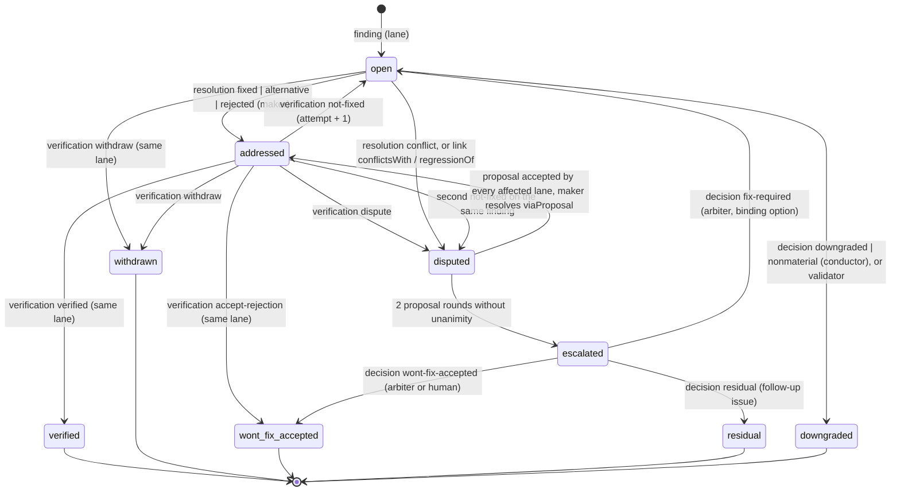

# Structured review exchange between makers and checkers (research, 2026-11-09)

> Record from the factory state-model design discussion (2026-11-09 to 2026-11-11), copied from the working notes. Paths to working files were rewritten to this folder; the text is otherwise as written. Where it differs from `docs/design/factory-state-model/decisions.md`, that file wins.

Status: research and proposal only. Nothing in the framework was changed. Inputs: the review contract
(`clients/common/docs/review-contract.md`), the review-loop fragment (`clients/common/phases/spec-phase-review.md`),
`spec-review-agent`, `adversarial-verifier`, the five-line question shape in `clients/claude/rules/continuous-work.md`,
the state model in `discussion-log.md` and the sibling report
`checker-landscape.md`, whose §4.2 also maps the contract onto SARIF. This report builds
on that mapping and reconciles the few points where it differs (§4.7).

Verification legend (the same one the sibling report uses):

- **[F]** read on the primary page during this session.
- **[S]** from web-search results that cite the named primary page; I did not open the page myself.
- **[L]** from this repository's generated forge API reference (`docs/api-reference/`).
- **[U]** not verified here (practitioner write-ups, background knowledge). Check before relying on it.

---

## 0. Summary

1. **No single standard covers the whole exchange.** SARIF 2.1.0 is the best fit for the *finding*. It has
   a rule reference, a level, a message, physical and logical locations, related locations, several fixes per
   result, fingerprints that survive edits, `baselineState` and `suppressions` with a status and a
   justification [F]. It has no record for "the maker answered" or "the checker verified", and it has no
   text-quote anchor for prose. Those three pieces have to be extensions.
2. **The W3C Web Annotation `TextQuoteSelector`** (exact text plus prefix and suffix) is the standard anchor
   for prose. It survives edits through fuzzy re-anchoring, as Hypothesis does it [F][S]. Use it for specs,
   issue text and, as a quote of the offending lines, for code as well.
3. **Proposal: `factory-review/v1`.** One JSON envelope carries seven record types: `finding`, `resolution`,
   `verification`, `link`, `proposal`, `decision` and `verdict`. A finding *is* a SARIF result: a subset,
   with the extensions in `result.properties` under `factory/…` keys. It can be dropped unchanged into a SARIF
   run for an optional upload. The other six types are small append-only events. The status of a finding is
   never stored. It is **derived by folding the events** in the server's comment order, the same total
   order the claim protocol already relies on.
4. **The reviewer writes meaning, the tool computes coordinates.** The LLM gives a quote and a symbol or
   section. The tool resolves them at the pinned commit SHA into lines, offsets and fingerprints, and rejects
   a quote it cannot find. This keeps the contract's rule that a location never carries a line number. It
   also removes hallucinated line numbers, which the Codex review cookbook names as the reason comments get
   rejected [S].
5. **Transport.** In-process, the envelope is a file (`review/<lane>/iteration-NN.json`). Between machines it
   is an **issue comment**: a hidden one-line marker, a Conventional-Comments rendering a human can read, and
   the JSON in a fenced block inside `<details>`. The issue's comments are the canonical log. PR/MR review
   threads, a commit status and optional SARIF or Code Quality reports are projections of it. One rule set
   works on GitHub and on GitLab Free: append-only, deterministic ids, at most 60,000 characters per comment
   (GitHub's limit is 65,536, GitLab's 1,000,000 [S]), and two labels as a cheap index.
6. **Things that do not work with one shared account and Free tiers:**
   - GitHub check runs need a GitHub App [F].
   - A PR author cannot APPROVE or REQUEST_CHANGES their own PR on GitHub [S].
   - SARIF ingestion needs GitHub Code Security on private repos [S], and GitLab Ultimate [F].
   - Issue comments cannot be resolved on GitHub. On GitLab, issue threads can be resolved in the UI, but
     the REST API has no resolve call for them [F][S].
   Gating therefore has to come from the records, published as a commit status (`factory/review`), which a
   personal token may set on both forges [L].
7. **Loop with N checkers.** Each checker verifies only its own findings, with evidence, at the new SHA.
   Conflicts are found mechanically (overlapping anchors with different fixes, a regression caused by another
   lane's fix, oscillating fingerprints) or declared by the maker. A conflict set gets at most **two
   proposal rounds**. Every affected checker must accept, with evidence. A reject must come with a
   counter-option that satisfies all the findings in the set. If that fails, a fresh **arbiter** decides
   from facts first and then from a configured standards precedence. A human is asked only for a genuine
   product decision, an irreversible or sensitive choice, or an exhausted budget, in the five-line shape.
   The literature supports this cap. Most of the benefit of debate comes from the first independent answers
   (NeurIPS 2025) [F]. Reviewer-critic loops drift into false consensus unless disagreement is made explicit
   (2026) [F].

---

## 1. What the framework has today, and what is missing for the exchange

| Contract element (`review-contract.md`) | Already gives | Missing for a cross-machine exchange |
|---|---|---|
| `### <ID> — <one line>` | per-iteration ids (`A1`, `B2`); `iter-NN/A2` for the log | an id that is stable across iterations and machines; recurrence is a best-effort annotation ("do NOT annotate if not confident") |
| `Severity: A \| B \| C \| D`; A+B gate | the materiality classes and the gate | a blocking flag a machine can read; a check that the grade and the gate agree |
| `Location: <artefact> § <section>`; never a line number | drift-free *semantic* anchor for specs | an anchor for code, the commit SHA it refers to, and a mechanical way to re-find it after edits |
| `Defect`, `Material-because`, `Proposed-edit` | the core of a finding | evidence (command, output, link); several options; a patch form; the standard or rule id in a fixed vocabulary |
| conductor's materiality gate, dedupe, `review-latest.md` | aggregation inside one session | the same aggregation when lanes run on other machines or clients |
| delta review from iteration 2 | "review the fix sites" | the maker's per-finding answer, and the checker's per-finding verification as records |
| cap question in the five-line shape | human escalation at the cap | multi-way conflicts between lanes; an agent arbiter before the human |
| lane file ≤ 8,000 bytes, verdict line `CLEAN` / `NOT-CLEAN (a A, b B)` | brevity | the same budget for JSON (§4.6) |

`adversarial-verifier` already has the right *verification* stance: it regenerates the evidence it grades
and returns `VERIFIED` or `REFUTED <ids>`. The proposal reuses that stance for each finding. A checker's
"verified" is valid only with re-run evidence.

---

## 2. Candidate formats and mechanisms: key facts

**SARIF 2.1.0 (OASIS)** [F] <https://docs.oasis-open.org/sarif/sarif/v2.1.0/os/sarif-v2.1.0-os.html>

- `result`:
  - `ruleId`, `rule`, `kind`, `level` (default `warning`), `message`, `locations`;
  - `relatedLocations`, `codeFlows`, `stacks`, `graphs`, `attachments`, `taxa`;
  - `fixes`, `fingerprints` / `partialFingerprints`, `guid` / `correlationGuid`;
  - `baselineState` (`new`, `unchanged`, `updated`, `absent`);
  - `suppressions` (`kind` inSource/external; `status` accepted/underReview/rejected; `justification`);
  - `rank`, `workItemUris`, `provenance`, `properties`.
- `kind` values: `pass`, `open`, `review`, `informational`, `notApplicable`, `fail`.
- `region`: 1-based `startLine`/`endLine`/`startColumn`/`endColumn`, `charOffset`/`charLength`, `snippet`;
  `contextRegion`.
- `fix`: `description` plus `artifactChanges[].replacements[]` (`deletedRegion`, `insertedContent`).
- `logicalLocation`: `name`, `fullyQualifiedName`, `kind`, `parentIndex`.
- `locationRelationship` kinds: `isContainedBy`, `contains`, `isEquivalentTo`, `isSimilarTo`,
  `isDescribedBy`, `describes`, `relevant`. Result-to-result relationships do not exist.
- Taxonomies (for example CWE) go through `toolComponent` and `taxa`.

**GitHub code scanning (a SARIF consumer)** [F]
<https://docs.github.com/en/code-security/reference/code-scanning/sarif-files/sarif-support>, [L] REST upload notes

- Uses only a listed subset: `ruleId`, `level`, `message.text`, `locations` (only the first is used),
  `partialFingerprints.primaryLocationLineHash`, `codeFlows`, `relatedLocations`, and the rule metadata.
  `fixes` and `suppressions` are not on the list.
- Limits:
  - 10 MB gzipped;
  - 25,000 results per run (top 5,000 kept);
  - 20 runs per file;
  - 1,000 uploads per hour.
- PR annotations appear only for lines the diff added or changed.
- Free on public repos. Private repos need GitHub Code Security; without it the upload fails with an
  explicit error [S] <https://docs.github.com/en/billing/concepts/product-billing/github-advanced-security>.

**GitLab SARIF ingestion** [F] <https://docs.gitlab.com/user/application_security/detect/sarif>

- Tier and keyword: Ultimate; `artifacts:reports:sarif`.
- Availability: 18.11 behind a feature flag, on by default in 19.1, GA in 19.2.
- Fields used: `ruleId`, `level`, `locations[0].physicalLocation`, `rank`, `suppressions[]`, and rule tags
  and relationships.
- Limits: 10 MB, 20 runs, 5,000 results per run.
- Where findings show: the security tab, the vulnerability report and the MR security widget.

**GitLab Code Quality (CodeClimate subset)** [F] <https://docs.gitlab.com/ci/testing/code_quality/>

- Entry format: a JSON array of `description`, `check_name`, `fingerprint`, `severity`
  (`info`/`minor`/`major`/`critical`/`blocker`), `location.path` and `location.lines.begin` (or
  `positions`). Other CodeClimate fields are ignored.
- New and resolved findings are computed against the target-branch baseline by `fingerprint`.
- Tiers: import and the MR widget are Free; the pipeline view needs Premium; inline diff annotations need
  Ultimate.

**GitLab security report schema** [F] <https://docs.gitlab.com/development/integrations/secure/>, [S]
<https://docs.gitlab.com/development/sec/vulnerability_tracking>,
<https://about.gitlab.com/blog/improved-scope-offset-fingerprinting/>

- Vulnerability fields: `identifiers` (the first is primary; at most 20), `location` (file, start and end
  line, class, method), `solution`, and `remediations` (a base64 diff).
- `tracking` carries `signatures` computed by algorithms ranked `hash` < `location` < `scope_offset` <
  `scope_offset_compressed` < `rule_value`. Scope+offset is enclosing scope plus line offset inside it,
  ignoring comments and blank lines, so moving code inside its scope keeps the identity.
- GitLab reports it as about 30 % more effective than line-based tracking (an ICSE 2025 SEIP paper) [S].
  **This is the model for our code fingerprint.**

**reviewdog Diagnostic Format (rdjson / rdjsonl)** [F]
<https://github.com/reviewdog/reviewdog/blob/master/proto/rdf/reviewdog.proto>, <https://github.com/reviewdog/reviewdog>

- Fields: `message`, `location{path, range}` (line from 1; column from 1, counted in UTF-8 bytes; the end
  is *exclusive*, so insertions can be expressed), `severity` (ERROR/WARNING/INFO), `source`,
  `code{value,url}`, `suggestions[]{range,text}`, `related_locations`, `original_output`.
- The format is still marked experimental, and each JSONL line is at most 64 KiB.
- reviewdog also reads SARIF, and filters results to the diff (`added`, `diff_context`, `file`,
  `nofilter`).
- Its `github-pr-review` and `gitlab-mr-discussion` reporters both support suggestions.

**LSP 3.17 Diagnostic + CodeAction / WorkspaceEdit** [F]
<https://microsoft.github.io/language-server-protocol/specifications/lsp/3.17/specification/>

- `Diagnostic`: `range` (0-based; UTF-16 by default, with position encoding negotiated), `severity` 1–4,
  `code`, `codeDescription.href`, `source`, `message`, `tags`, `relatedInformation`, `data`.
- `CodeAction`: `title`, `kind` (`quickfix`, `refactor`, …), `diagnostics`, `isPreferred`, `disabled`,
  `edit`, `command`.
- `WorkspaceEdit`: `changes`, versioned `documentChanges`, and `changeAnnotations` with
  `needsConfirmation`.
- **This is the best model for "several options, one preferred".** There is no identity and no lifecycle,
  and it renders in editors only.

**GitHub Checks API annotations** [F] <https://docs.github.com/en/rest/checks/runs>

- An annotation has `path`, `start_line`, `end_line`, optional columns (same line only),
  `annotation_level` (`notice`/`warning`/`failure`), `message` (64 KB), `title` (255 characters) and
  `raw_details`.
- Limits: 50 annotations per request; summary and text 65,535 characters each; at most 3 requested actions.
- **Write access is GitHub App only.** A user token can read check runs but not create them.

**GitHub PR review comments and threads** [F] <https://docs.github.com/en/rest/pulls/comments>,
<https://docs.github.com/en/pull-requests/collaborating-with-pull-requests/reviewing-changes-in-pull-requests/incorporating-feedback-in-your-pull-request>,
[L] `PullRequestReviewThread`, `resolveReviewThread`

- A comment has `commit_id`, `path`, `line`/`start_line`, `side`/`start_side`, and `subject_type`
  (`line` or `file`).
- Replies go only to top-level comments. A comment can go stale when later commits change its line.
- Threads (GraphQL only) have `isResolved`, `isOutdated`, `line`, `originalLine`, `startLine`,
  `subjectType` and `resolvedBy`. Resolving and unresolving are GraphQL-only [L].
- Suggestion blocks can be applied one by one or in a batch; each suggester becomes a co-author.
- A PR author cannot approve their own PR, and the API refuses REQUEST_CHANGES from the author [S]
  <https://github.com/dear-github/dear-github/issues/332>.
- "Require conversation resolution" is branch protection. On private repos it needs Pro or Team [S].

**GitLab MR diff discussions** [F] <https://docs.gitlab.com/api/discussions/>,
<https://docs.gitlab.com/user/project/merge_requests/reviews/suggestions/>

- A diff note's `position` has `base_sha`, `start_sha`, `head_sha`, `position_type`, `new_path`/`old_path`,
  `new_line`/`old_line` and `line_range`.
- Resolve a thread with `PUT …/discussions/:id?resolved=true`. Reply with `POST …/discussions/:id/notes`.
- Suggestion syntax is `suggestion:-a+b`, at most 200 lines, with batch apply. It is Free.
- "All threads must be resolved" is a Free merge check [S] <https://docs.gitlab.com/user/project/merge_requests/>.
- The MR author approving their own MR is prevented by default; the setting needs Premium [S].

**Gerrit** [F] <https://gerrit-review.googlesource.com/Documentation/rest-api-changes.html>,
[S] <https://www.gerritcodereview.com/3.10.html>, <https://www.gerritcodereview.com/2020-11-18-gerrit-news-jun-nov-2020.html>

- Comments carry `unresolved` and `fix_suggestions[]`. A suggestion has `fix_id`, `description` and
  `replacements[]`; a replacement has `path`, `range` and `replacement`. A `CommentRange` has 1-based lines
  and 0-based characters.
- Robot comments are deprecated in favour of the Checks API and fixes on human comments (3.10, behind an
  experiment flag).
- "Ported comments" carry unresolved comments forward to the latest patch set.
- **Gerrit is not our forge. It is the proof that per-comment `unresolved` + fix suggestions + porting
  across revisions is a workable model.**

**W3C Web Annotation Data Model** [F] <https://www.w3.org/TR/annotation-model/>, [S]
<https://web.hypothes.is/blog/fuzzy-anchoring/>, <https://github.com/robertknight/anchor-quote>

- Selectors:
  - `TextQuoteSelector`: `exact`, `prefix`, `suffix`, over normalised text;
  - `TextPositionSelector`: `start` inclusive, `end` exclusive. The spec calls it brittle under edits.
  - `RangeSelector`, `FragmentSelector`, and `refinedBy` for chaining;
  - several selectors may describe the same target.
- Hypothesis stores range, position and quote selectors, and anchors in this order:
  1. the range or position, checked against the quote;
  2. a fuzzy match on the context;
  3. a fuzzy match on the quote, within an error bound.
  When everything fails, the annotation is an "orphan".
- Lessons:
  - Short quotes jump to other occurrences, so orphaning beats a wrong match.
  - A 2015 study of public web pages found about 22 % of annotations orphaned [S].
- **No lifecycle and no rendering on any forge.**

**Conventional Comments** [F] <https://conventionalcomments.org/>

- Shape: `<label> [decorations]: <subject>`.
- Labels: `praise`, `nitpick`, `suggestion`, `issue`, `todo`, `question`, `thought`, `chore`, `note`,
  `typo`, `polish`, `quibble`.
- Decorations: `(blocking)`, `(non-blocking)`, `(if-minor)`.
- Meant to be machine-parseable. **The right one-line rendering for humans, not a data format.**

**A2A v1.0** [F] <https://a2a-protocol.org/latest/specification/>, [S]
<https://www.linuxfoundation.org/press/a2a-protocol-surpasses-150-organizations-lands-in-major-cloud-platforms-and-sees-enterprise-production-use-in-first-year>

- Task states: submitted, working, input-required, completed, failed, canceled, rejected, auth-required.
- `Message`: `messageId`, `role`, `parts`, `contextId`, `taskId`, `referenceTaskIds`, `extensions`.
- `Part`: exactly one of `text`, `raw`, `url` or `data` (JSON), plus `mediaType`. The v0.3 `kind`
  discriminator and `DataPart` are gone. `Artifact`: `artifactId`, `parts`.
- Bindings: JSON-RPC, gRPC and HTTP+JSON, with webhook push notifications. There is no store-and-forward
  binding, and custom bindings must support all core operations.
- v1.0 shipped March 2026 [S]. Its move into the Agentic AI Foundation is reported only by secondary
  sources [S].
- **Usable only as a payload pattern** (our envelope fits in a `data` part). The task lifecycle models the
  review *job*, not the finding.

**MCP structured tool output** [F] <https://modelcontextprotocol.io/specification/2025-06-18/server/tools>

- A tool may declare an `outputSchema`. The server then MUST return conforming `structuredContent`, SHOULD
  also return the serialised JSON as text, and clients SHOULD validate it.
- **An in-process validation channel** (a later option: expose the record tool as an MCP server to both
  Claude Code and Kiro). It is not a transport between machines.

**De-facto LLM review schemas** [S]
<https://developers.openai.com/cookbook/examples/codex/build_code_review_with_codex_sdk>

- The Codex review schema: `findings[]{title ≤ 80, body, confidence_score, priority 0–3,
  code_location{absolute_file_path, line_range}}`, plus `overall_correctness` and `overall_explanation`.
- It is line-based, has no fixes and no lifecycle. It shows the industry converging on "JSON findings +
  verdict", and on line numbers as the weak point.
- Practitioner multi-agent review protocols [U] do the same thing (a logical AND across scanner lanes, about
  three iterations, then a human; an `oscillation_detected` flag). Examples:
  <https://skillsmp.com/creators/brave/chromium/agents-skills-multi-agent-code-review>,
  <https://github.com/calimero-network/ai-code-reviewer>.

---

## 3. Comparison

Fit for this framework's needs. ✔ = yes, ◐ = partial, ✘ = no.

| Candidate | Code targets | Prose targets | Fixes / options | Stable identity across edits | Status lifecycle | GitHub + GitLab rendering | Tooling / availability |
|---|---|---|---|---|---|---|---|
| **SARIF 2.1.0** | ✔ region + snippet + logical location | ◐ region/char offsets + snippet; no quote selector | ✔ `fixes[]`, several per result; each needs `artifactChanges` | ✔ `fingerprints`, `partialFingerprints`, `correlationGuid`, `baselineState` | ◐ `suppressions.status` + `justification`; nothing for addressed or verified | ◐ GitHub code scanning (Code Security on private repos); GitLab Ultimate ≥ 19.2 | ✔ widest: CodeQL, Semgrep, cdk-nag, Checkov, reviewdog input, SDKs |
| GitLab Code Quality | ◐ path + begin line | ✘ | ✘ | ◐ `fingerprint`, against the target branch | ✘ (new/resolved derived) | ◐ GitLab only (widget Free; inline Ultimate) | ◐ converters from SARIF |
| GitLab security report | ✔ file, lines, class, method | ✘ | ◐ `remediations` diff | ✔ `tracking` signatures (scope+offset) | ◐ platform vulnerability states | ◐ GitLab Ultimate only | ◐ GitLab analyzers |
| reviewdog rdjson | ✔ exclusive end, insertion-capable | ◐ | ✔ `suggestions[]` | ✘ | ✘ | ✔ both forges via reporters, diff-filtered | ◐ one tool; "experimental" |
| LSP Diagnostic + CodeAction | ✔ | ◐ | ✔ options with `isPreferred`, multi-file edits | ✘ (`data` only) | ✘ | ✘ editors only | ✔ IDEs (Kiro is an IDE) |
| GitHub Checks annotations | ✔ | ◐ | ✘ | ✘ | ◐ per check run, not per annotation | ◐ GitHub only; **GitHub App only** | ◐ |
| GitHub PR review threads + suggestions | ✔ diff lines only, pinned to `commit_id` | ◐ diff only | ◐ one suggestion block per comment | ◐ thread id; `isOutdated` | ◐ resolved / unresolved | ◐ GitHub only | ✔ REST + GraphQL |
| GitLab MR discussions + suggestions | ✔ `position` with three SHAs | ◐ diff only | ◐ `suggestion:-a+b`, ≤ 200 lines | ◐ discussion id; auto-resolve when outdated | ◐ resolved; Free merge check | ◐ GitLab only | ✔ REST |
| Gerrit comments + `fix_suggestions` | ✔ | ◐ | ✔ replacements | ◐ ported comments | ◐ `unresolved` | ✘ not our forge | ✘ pattern only |
| W3C Web Annotation selectors | ◐ text only | ✔ quote + position, multiple selectors, fuzzy re-anchoring | ◐ `motivation: editing` + body | ◐ via re-anchoring; orphans | ✘ (replies only) | ✘ | ◐ anchoring libraries |
| Conventional Comments | ✘ | ✘ | ◐ free text | ✘ | ◐ blocking / non-blocking | ✔ plain Markdown everywhere | ✔ none needed |
| A2A v1.0 | ✘ (payload only) | ✘ | ✘ | ✘ | ◐ task states (job level) | ✘ needs HTTP endpoints | ◐ SDKs in 5 languages |
| MCP structured output | ✘ (channel only) | ✘ | ✘ | ✘ | ✘ | ✘ | ✔ both clients speak MCP |
| Codex review schema | ◐ line range only | ✘ | ✘ | ✘ | ✘ | ◐ via jq to comments | ◐ one vendor |

**Conclusion.** Take the finding from SARIF, the prose anchor from W3C (`TextQuoteSelector`), the option
model from LSP (several options, one preferred, each optionally an edit), identity from GitLab's
scope+offset idea, and the human line from Conventional Comments. Keep the lifecycle in our own append-only
records, because no candidate has *addressed → verified* semantics. Forge threads, check runs and SARIF
ingestion are tier-dependent and forge-specific. Treat them as projections, never as the source of truth.

---

## 4. Proposal: `factory-review/v1` records

### 4.1 Design decisions

- **R1 — A finding is a SARIF result.** The `finding` record wraps a SARIF 2.1.0 `result`, restricted to a
  subset. Every framework concept that SARIF lacks goes into `result.properties` (or
  `location.properties`, `fix.properties`) under `factory/` keys. A SARIF exporter copies results into
  `runs[]`, one run per lane (`tool.driver.name` = lane, as in checker-landscape §4.2). SARIF consumers
  ignore unknown property keys.
- **R2 — Everything else is an append-only event.** `resolution`, `verification`, `link`, `proposal`,
  `decision` and `verdict` refer to findings by id. Records are never edited. A correction is a new record.
  The state is a fold (§4.4). This is what makes concurrent writers from several machines safe: neither forge
  has an optimistic lock on comment edits.
- **R3 — The reviewer writes meaning; the tool computes coordinates, ids and fingerprints.**
  - The lane writes a `TextQuoteSelector` (the exact offending text, code or prose, with an optional
    prefix and suffix) and a logical location (symbol, or section / requirement path).
  - `review_records.py anchor` resolves the quote at the envelope's commit SHA and fills in
    `region`/`snippet`/`contextRegion`.
  - It also computes the two partial fingerprints and assigns the id.
  - A quote that is not found, or matches ambiguously, sends the finding back to the lane.
- **R4 — The materiality gate becomes mostly mechanical.** For a blocking finding the validator requires:
  - a `factory/materialBecause` whose `ref` is an `AC-n` or `UB-n` id that exists in the spec at the pinned
    SHA, or one of the five failure classes (with `rule` for `unmaintainable-by-rule`);
  - at least one concrete option;
  - at least one evidence item.
  A finding that fails is downgraded to C by the validator, not by judgement. The conductor keeps the
  judgement part: forbidden findings, scope creep, and "re-opened text that already passed".
- **R5 — The forge is a carrier, not a database.** The canonical log is the comments of the **work issue**.
  It exists from START, survives a closed or replaced PR, and serves cross-issue feedback. PR/MR threads, the
  commit status and SARIF or Code Quality files are projections, regenerated from the fold.

### 4.2 JSON Schema (draft 2020-12)

```json
{
  "$schema": "https://json-schema.org/draft/2020-12/schema",
  "$id": "https://example.invalid/factory/schemas/review-envelope/v1.json",
  "title": "factory-review/v1 envelope",
  "type": "object",
  "additionalProperties": false,
  "required": ["schema", "envelopeId", "createdAt", "actor", "subject", "to", "records"],
  "properties": {
    "schema": { "const": "factory-review/v1" },
    "envelopeId": { "type": "string", "pattern": "^E-[0-9a-f]{12}$",
      "description": "deterministic: hash of actor.role, subject.issue, subject.iteration, subject.commit and the record ids" },
    "createdAt": { "type": "string", "format": "date-time" },
    "actor": { "$ref": "#/$defs/actor" },
    "subject": { "$ref": "#/$defs/subject" },
    "to": { "$ref": "#/$defs/address" },
    "part": { "type": "object", "additionalProperties": false, "required": ["n", "of"],
      "properties": { "n": { "type": "integer", "minimum": 1 }, "of": { "type": "integer", "minimum": 1 } } },
    "records": { "type": "array", "minItems": 1, "items": { "$ref": "#/$defs/record" } }
  },
  "$defs": {
    "sha": { "type": "string", "pattern": "^[0-9a-f]{40}$" },
    "lane": { "type": "string", "pattern": "^[a-z][a-z0-9-]{1,40}$",
      "description": "role name of the checker: spec-review-agent, test-architect, standards-reviewer, best-practice-reviewer, security-reviewer, devops-iac-reviewer, dead-code, docs, ..." },
    "findingId": { "type": "string", "pattern": "^F-[a-z]{2,6}-[0-9a-f]{8}(\\.[0-9]+)?$" },
    "recordId": { "type": "string", "pattern": "^[FRVLPDX]-[A-Za-z0-9.-]{3,96}$" },
    "actor": {
      "type": "object", "additionalProperties": false, "required": ["worker", "client", "role"],
      "properties": {
        "worker": { "type": "string", "description": "<host>/<session>, the identity the claim lease uses" },
        "client": { "enum": ["claude-code", "kiro", "kiro-crew", "inbox"] },
        "role": { "type": "string", "description": "maker | conductor | arbiter | inbox | <lane>" },
        "agent": { "type": "string" },
        "model": { "type": "string" },
        "onIssue": { "type": "integer", "minimum": 1, "description": "issue whose claim the worker holds, when it is not subject.issue (cross-issue feedback)" }
      }
    },
    "subject": {
      "type": "object", "additionalProperties": false,
      "required": ["forge", "repo", "issue", "stage", "iteration", "commit"],
      "properties": {
        "forge": { "enum": ["github", "gitlab"] },
        "repo": { "type": "string", "description": "owner/name, or group/subgroup/name" },
        "issue": { "type": "integer", "minimum": 1 },
        "pr": { "type": "integer", "minimum": 1, "description": "PR number or MR iid" },
        "stage": { "enum": ["START", "SPEC-REQUIRED", "IMPLEMENTATION-READY", "TEST-READY", "REWORK-REQUIRED", "CLOSE-READY"] },
        "tier": { "enum": ["S", "M", "L"] },
        "iteration": { "type": "integer", "minimum": 1 },
        "commit": { "$ref": "#/$defs/sha", "description": "the revision every record in the envelope was produced against" }
      }
    },
    "address": {
      "type": "object", "additionalProperties": false, "required": ["issue", "role"],
      "properties": { "repo": { "type": "string" }, "issue": { "type": "integer", "minimum": 1 }, "role": { "type": "string" } }
    },
    "evidence": {
      "type": "object", "additionalProperties": false, "required": ["kind"],
      "properties": {
        "kind": { "enum": ["command", "ci-run", "file", "link", "test"] },
        "command": { "type": "string", "maxLength": 500 },
        "exitCode": { "type": "integer" },
        "excerpt": { "type": "string", "maxLength": 1000 },
        "uri": { "type": "string" },
        "commit": { "$ref": "#/$defs/sha" },
        "title": { "type": "string", "maxLength": 200 }
      },
      "allOf": [
        { "if": { "properties": { "kind": { "enum": ["command", "test"] } } }, "then": { "required": ["command", "exitCode", "excerpt"] } },
        { "if": { "properties": { "kind": { "enum": ["ci-run", "link"] } } }, "then": { "required": ["uri"] } },
        { "if": { "properties": { "kind": { "const": "file" } } }, "then": { "required": ["uri", "commit"] } }
      ]
    },
    "textQuote": {
      "type": "object", "additionalProperties": false, "required": ["type", "exact"],
      "properties": {
        "type": { "const": "TextQuoteSelector" },
        "exact": { "type": "string", "minLength": 12, "maxLength": 600 },
        "prefix": { "type": "string", "maxLength": 64 },
        "suffix": { "type": "string", "maxLength": 64 }
      }
    },
    "region": {
      "type": "object",
      "description": "SARIF region subset, computed by the tool at the anchoring commit; reviewers never write it",
      "properties": {
        "startLine": { "type": "integer", "minimum": 1 }, "endLine": { "type": "integer", "minimum": 1 },
        "startColumn": { "type": "integer", "minimum": 1 }, "endColumn": { "type": "integer", "minimum": 1 },
        "charOffset": { "type": "integer", "minimum": 0 }, "charLength": { "type": "integer", "minimum": 0 },
        "snippet": { "type": "object", "required": ["text"], "properties": { "text": { "type": "string" } } }
      }
    },
    "location": {
      "type": "object", "required": ["physicalLocation", "properties"],
      "properties": {
        "physicalLocation": {
          "type": "object", "required": ["artifactLocation"],
          "properties": {
            "artifactLocation": { "type": "object", "required": ["uri"], "properties": { "uri": { "type": "string",
              "description": "repo-relative path, or the issue / comment URL for issue-text targets" } } },
            "region": { "$ref": "#/$defs/region" },
            "contextRegion": { "$ref": "#/$defs/region" }
          }
        },
        "logicalLocations": { "type": "array", "items": { "type": "object", "required": ["fullyQualifiedName", "kind"],
          "properties": { "fullyQualifiedName": { "type": "string" },
            "kind": { "type": "string", "description": "SARIF kinds (function, member, type, module, resource) or section / requirement for prose" } } } },
        "properties": {
          "type": "object", "required": ["factory/targetKind", "factory/commit"],
          "properties": {
            "factory/targetKind": { "enum": ["code", "document", "issue-text"] },
            "factory/commit": { "$ref": "#/$defs/sha" },
            "factory/textQuote": { "$ref": "#/$defs/textQuote" },
            "factory/bodySha256": { "type": "string", "pattern": "^[0-9a-f]{64}$", "description": "hash of the issue body or comment at review time" }
          },
          "allOf": [ { "if": { "properties": { "factory/targetKind": { "const": "issue-text" } } }, "then": { "required": ["factory/bodySha256"] } } ]
        }
      },
      "anyOf": [
        { "properties": { "properties": { "required": ["factory/textQuote"] } } },
        { "required": ["logicalLocations"], "properties": { "logicalLocations": { "minItems": 1 } } }
      ]
    },
    "option": {
      "type": "object", "required": ["description", "properties"],
      "description": "SARIF fix superset; an option without artifactChanges is dropped from a SARIF export",
      "properties": {
        "description": { "type": "object", "required": ["text"], "properties": { "text": { "type": "string", "maxLength": 300 } } },
        "artifactChanges": { "type": "array", "items": { "type": "object", "required": ["artifactLocation", "replacements"],
          "properties": {
            "artifactLocation": { "type": "object", "required": ["uri"], "properties": { "uri": { "type": "string" } } },
            "replacements": { "type": "array", "minItems": 1, "items": { "type": "object", "required": ["deletedRegion"],
              "properties": {
                "deletedRegion": { "$ref": "#/$defs/region" },
                "insertedContent": { "type": "object", "required": ["text"], "properties": { "text": { "type": "string" } } },
                "properties": { "type": "object", "properties": { "factory/deletedQuote": { "$ref": "#/$defs/textQuote" } } } } } } } } },
        "properties": {
          "type": "object", "required": ["factory/option", "factory/consequence"],
          "properties": {
            "factory/option": { "type": "integer", "minimum": 1, "maximum": 4 },
            "factory/recommended": { "type": "boolean" },
            "factory/consequence": { "type": "string", "maxLength": 200 },
            "factory/edit": { "type": "string", "maxLength": 2000, "description": "replacement text, or 'delete <exactly what>'" },
            "factory/patchRef": { "type": "string", "description": "<path>@<sha> of a unified diff on the issue branch, for edits over 4,000 characters" }
          }
        }
      },
      "anyOf": [
        { "required": ["artifactChanges"] },
        { "properties": { "properties": { "anyOf": [ { "required": ["factory/edit"] }, { "required": ["factory/patchRef"] } ] } } }
      ]
    },
    "sarifResult": {
      "type": "object",
      "required": ["ruleId", "level", "kind", "message", "locations", "partialFingerprints", "properties"],
      "properties": {
        "ruleId": { "type": "string", "description": "namespaced: cwe/<n>, ac/AC-n, ub/UB-n, rule/<rule file>, iac/<tool>/<rule>, failure/<class>, std/<standard>/<clause>" },
        "level": { "enum": ["error", "warning", "note"] },
        "kind": { "enum": ["fail", "review", "informational"] },
        "message": { "type": "object", "required": ["text"],
          "properties": { "text": { "type": "string", "maxLength": 200, "description": "the Defect sentence" }, "markdown": { "type": "string" } } },
        "locations": { "type": "array", "minItems": 1, "maxItems": 1, "items": { "$ref": "#/$defs/location" } },
        "relatedLocations": { "type": "array", "maxItems": 5, "items": { "$ref": "#/$defs/location" } },
        "taxa": { "type": "array", "items": { "type": "object", "required": ["id", "toolComponent"],
          "properties": { "id": { "type": "string" }, "toolComponent": { "type": "object", "required": ["name"], "properties": { "name": { "type": "string" } } } } } },
        "partialFingerprints": { "type": "object", "required": ["factory/v1", "factory/target/v1"], "additionalProperties": { "type": "string" } },
        "fixes": { "type": "array", "maxItems": 4, "items": { "$ref": "#/$defs/option" } },
        "properties": {
          "type": "object",
          "required": ["factory/lane", "factory/severity", "factory/blocking", "factory/reasoning", "factory/evidence"],
          "properties": {
            "factory/lane": { "$ref": "#/$defs/lane" },
            "factory/severity": { "enum": ["A", "B", "C", "D"] },
            "factory/blocking": { "type": "boolean" },
            "factory/materialBecause": { "type": "object", "additionalProperties": false, "required": ["kind", "ref", "because"],
              "properties": {
                "kind": { "enum": ["acceptance-criterion", "unchanged-behaviour", "failure-class"] },
                "ref": { "type": "string", "description": "AC-n | UB-n | wrong-behaviour | security | data-loss | regression | unmaintainable-by-rule" },
                "rule": { "type": "string" },
                "because": { "type": "string", "maxLength": 300 } } },
            "factory/standard": { "type": "object", "required": ["id"],
              "properties": { "id": { "type": "string" }, "clause": { "type": "string" }, "uri": { "type": "string" } } },
            "factory/reasoning": { "type": "string", "maxLength": 1500 },
            "factory/evidence": { "type": "array", "minItems": 1, "maxItems": 5, "items": { "$ref": "#/$defs/evidence" } },
            "factory/relationships": { "type": "array", "items": { "type": "object", "required": ["kind", "id"],
              "properties": { "kind": { "enum": ["conflictsWith", "duplicateOf", "regressionOf", "supersedes", "dependsOn"] },
                "id": { "$ref": "#/$defs/findingId" } } } },
            "factory/downgradedFrom": { "enum": ["A", "B"] },
            "factory/downgradeReason": { "type": "string", "maxLength": 300 }
          }
        }
      },
      "allOf": [
        { "if": { "properties": { "properties": { "properties": { "factory/severity": { "enum": ["A", "B"] } } } } },
          "then": { "properties": { "properties": { "properties": { "factory/blocking": { "const": true } } } } },
          "else": { "properties": { "properties": { "properties": { "factory/blocking": { "const": false } } } } } },
        { "if": { "properties": { "properties": { "properties": { "factory/blocking": { "const": true } } } } },
          "then": { "required": ["fixes"],
            "properties": { "fixes": { "minItems": 1 }, "level": { "const": "error" }, "kind": { "const": "fail" },
              "properties": { "required": ["factory/materialBecause"] } } } }
      ]
    },
    "finding": {
      "type": "object", "additionalProperties": false, "required": ["type", "id", "result"],
      "properties": { "type": { "const": "finding" }, "id": { "$ref": "#/$defs/findingId" }, "result": { "$ref": "#/$defs/sarifResult" } }
    },
    "resolution": {
      "type": "object", "additionalProperties": false, "required": ["type", "id", "of", "action", "explanation"],
      "properties": {
        "type": { "const": "resolution" },
        "id": { "$ref": "#/$defs/recordId" },
        "of": { "$ref": "#/$defs/findingId" },
        "action": { "enum": ["fixed", "alternative", "rejected", "conflict"] },
        "option": { "type": "integer", "minimum": 1 },
        "viaProposal": { "$ref": "#/$defs/recordId" },
        "commit": { "$ref": "#/$defs/sha" },
        "rejectedBecause": { "enum": ["not-a-defect", "not-material", "out-of-scope", "evidence-wrong"] },
        "conflictsWith": { "type": "array", "minItems": 1, "items": { "$ref": "#/$defs/findingId" } },
        "explanation": { "type": "string", "maxLength": 1000 },
        "evidence": { "type": "array", "items": { "$ref": "#/$defs/evidence" } }
      },
      "allOf": [
        { "if": { "properties": { "action": { "enum": ["fixed", "alternative"] } } }, "then": { "required": ["commit"] } },
        { "if": { "properties": { "action": { "const": "fixed" } } }, "then": { "anyOf": [ { "required": ["option"] }, { "required": ["viaProposal"] } ] } },
        { "if": { "properties": { "action": { "const": "rejected" } } }, "then": { "required": ["rejectedBecause", "evidence"], "properties": { "evidence": { "minItems": 1 } } } },
        { "if": { "properties": { "action": { "const": "conflict" } } }, "then": { "required": ["conflictsWith"] } }
      ]
    },
    "verification": {
      "type": "object", "additionalProperties": false, "required": ["type", "id", "of", "verdict", "commit", "evidence"],
      "properties": {
        "type": { "const": "verification" },
        "id": { "$ref": "#/$defs/recordId" },
        "of": { "$ref": "#/$defs/recordId", "description": "a finding id; or a proposal id, then the verdict is a ballot (accept | reject)" },
        "verdict": { "enum": ["verified", "not-fixed", "accept-rejection", "dispute", "withdraw", "accept", "reject"] },
        "commit": { "$ref": "#/$defs/sha" },
        "anchorState": { "enum": ["anchored", "shifted", "relocated", "changed", "orphaned"] },
        "evidence": { "type": "array", "minItems": 1, "items": { "$ref": "#/$defs/evidence" } },
        "unmetClause": { "type": "string", "maxLength": 300, "description": "the rule clause still violated" },
        "counterOption": { "$ref": "#/$defs/proposalOption" },
        "note": { "type": "string", "maxLength": 1000 }
      },
      "allOf": [ { "if": { "properties": { "verdict": { "enum": ["not-fixed", "dispute", "reject"] } } }, "then": { "required": ["unmetClause"] } } ]
    },
    "link": {
      "type": "object", "additionalProperties": false, "required": ["type", "id", "kind", "findings", "reason"],
      "properties": {
        "type": { "const": "link" }, "id": { "$ref": "#/$defs/recordId" },
        "kind": { "enum": ["conflictsWith", "duplicateOf", "regressionOf"] },
        "candidate": { "type": "boolean", "description": "true when detected mechanically and not yet confirmed by the maker" },
        "findings": { "type": "array", "minItems": 2, "items": { "$ref": "#/$defs/findingId" } },
        "reason": { "type": "string", "maxLength": 500 }
      }
    },
    "proposalOption": {
      "type": "object", "additionalProperties": false, "required": ["option", "description", "consequence", "satisfies"],
      "properties": {
        "option": { "type": "integer", "minimum": 1, "maximum": 3 },
        "recommended": { "type": "boolean" },
        "description": { "type": "string", "maxLength": 300 },
        "consequence": { "type": "string", "maxLength": 200 },
        "satisfies": { "type": "object", "minProperties": 2, "propertyNames": { "$ref": "#/$defs/findingId" },
          "additionalProperties": { "type": "string", "maxLength": 300 }, "description": "for every finding in the set: how its rule is met" },
        "commit": { "$ref": "#/$defs/sha", "description": "the option implemented, so ballots are cast on evidence" },
        "patchRef": { "type": "string" }
      }
    },
    "proposal": {
      "type": "object", "additionalProperties": false, "required": ["type", "id", "resolves", "round", "options"],
      "properties": {
        "type": { "const": "proposal" }, "id": { "$ref": "#/$defs/recordId" },
        "resolves": { "type": "array", "minItems": 2, "items": { "$ref": "#/$defs/findingId" } },
        "round": { "type": "integer", "minimum": 1, "maximum": 2 },
        "options": { "type": "array", "minItems": 1, "maxItems": 3, "items": { "$ref": "#/$defs/proposalOption" } }
      }
    },
    "decision": {
      "type": "object", "additionalProperties": false, "required": ["type", "id", "by", "of", "outcome", "rationale"],
      "properties": {
        "type": { "const": "decision" }, "id": { "$ref": "#/$defs/recordId" },
        "by": { "enum": ["conductor", "arbiter", "human"] },
        "of": { "type": "array", "minItems": 1, "items": { "$ref": "#/$defs/recordId" } },
        "outcome": { "enum": ["downgraded", "nonmaterial", "option-chosen", "per-finding", "residual", "needs-human"] },
        "proposal": { "$ref": "#/$defs/recordId" },
        "option": { "type": "integer", "minimum": 1 },
        "perFinding": { "type": "object", "propertyNames": { "$ref": "#/$defs/findingId" },
          "additionalProperties": { "enum": ["fix-required", "wont-fix-accepted", "residual"] } },
        "precedence": { "type": "array", "items": { "type": "string" }, "description": "the ranked standards the arbiter applied" },
        "rationale": { "type": "string", "maxLength": 1000 },
        "evidence": { "type": "array", "items": { "$ref": "#/$defs/evidence" } },
        "humanQuestion": { "type": "string", "maxLength": 700, "description": "the five-line question, plain words, recommended option first" },
        "humanAnswerUri": { "type": "string", "description": "link to the human's own comment; required when by = human" },
        "followUpIssue": { "type": "integer", "minimum": 1 }
      },
      "allOf": [
        { "if": { "properties": { "by": { "const": "human" } } }, "then": { "required": ["humanAnswerUri"] } },
        { "if": { "properties": { "outcome": { "const": "needs-human" } } }, "then": { "required": ["humanQuestion"] } },
        { "if": { "properties": { "outcome": { "const": "per-finding" } } }, "then": { "required": ["perFinding"] } }
      ]
    },
    "verdict": {
      "type": "object", "additionalProperties": false, "required": ["type", "id", "lane", "verdict", "counts"],
      "properties": {
        "type": { "const": "verdict" }, "id": { "$ref": "#/$defs/recordId" },
        "lane": { "$ref": "#/$defs/lane" },
        "verdict": { "enum": ["CLEAN", "NOT-CLEAN"] },
        "counts": { "type": "object", "additionalProperties": false, "required": ["A", "B", "C", "D"],
          "properties": { "A": { "type": "integer", "minimum": 0 }, "B": { "type": "integer", "minimum": 0 },
            "C": { "type": "integer", "minimum": 0 }, "D": { "type": "integer", "minimum": 0 } } },
        "coverage": { "type": "string", "maxLength": 2000, "description": "test-architect only: TEST-READY or the GAP rows" }
      }
    },
    "record": { "oneOf": [
      { "$ref": "#/$defs/finding" }, { "$ref": "#/$defs/resolution" }, { "$ref": "#/$defs/verification" },
      { "$ref": "#/$defs/link" }, { "$ref": "#/$defs/proposal" }, { "$ref": "#/$defs/decision" }, { "$ref": "#/$defs/verdict" } ] }
  }
}
```

Constraints the schema cannot express are checked by `review_records.py validate` and by the fold:

- the `AC-n` or `UB-n` in `materialBecause.ref` exists in the spec at the commit;
- the quote resolves uniquely;
- `actor.role` matches the record type (§4.4);
- the prose budget (§4.6);
- the deny-list (§4.5).

### 4.3 Examples

**(1) A full envelope.** The security lane reviews issue #212, iteration 1, and raises a code finding.

```json
{
  "schema": "factory-review/v1",
  "envelopeId": "E-7c41a09e2b55",
  "createdAt": "2026-11-09T10:14:03Z",
  "actor": { "worker": "ws-berlin-02/7f3c", "client": "claude-code", "role": "security-reviewer", "agent": "security-reviewer" },
  "subject": { "forge": "github", "repo": "acme/uploads", "issue": 212, "pr": 230, "stage": "IMPLEMENTATION-READY",
    "tier": "M", "iteration": 1, "commit": "4b1e9c27d0a35f68e2c41b7d9a06f3e58c2d71ab" },
  "to": { "issue": 212, "role": "maker" },
  "records": [
    {
      "type": "finding",
      "id": "F-sec-3e7a91c0",
      "result": {
        "ruleId": "cwe/732",
        "level": "error",
        "kind": "fail",
        "message": { "text": "The application role is granted every S3 action on every resource." },
        "locations": [ {
          "physicalLocation": {
            "artifactLocation": { "uri": "infra/storage_stack.py" },
            "region": { "startLine": 41, "endLine": 44, "snippet": { "text": "actions=[\"s3:*\"],\n            resources=[\"*\"]," } }
          },
          "logicalLocations": [ { "fullyQualifiedName": "infra.storage_stack.StorageStack.__init__", "kind": "function" } ],
          "properties": {
            "factory/targetKind": "code",
            "factory/commit": "4b1e9c27d0a35f68e2c41b7d9a06f3e58c2d71ab",
            "factory/textQuote": { "type": "TextQuoteSelector", "exact": "actions=[\"s3:*\"],\n            resources=[\"*\"],",
              "prefix": "app_role.add_to_policy(iam.PolicyStatement(\n            ", "suffix": "\n        ))" }
          }
        } ],
        "taxa": [ { "id": "732", "toolComponent": { "name": "CWE" } } ],
        "partialFingerprints": { "factory/v1": "3e7a91c04d2b8f16", "factory/target/v1": "b90c13e7aa4f0d25" },
        "fixes": [ {
          "description": { "text": "Grant only GetObject and PutObject on the uploads prefix of this bucket." },
          "artifactChanges": [ { "artifactLocation": { "uri": "infra/storage_stack.py" },
            "replacements": [ { "deletedRegion": { "startLine": 41, "endLine": 44 },
              "insertedContent": { "text": "actions=[\"s3:GetObject\", \"s3:PutObject\"],\n            resources=[bucket.arn_for_objects(\"uploads/*\")]," } } ] } ],
          "properties": { "factory/option": 1, "factory/recommended": true,
            "factory/consequence": "The app can read and write uploads only; nothing else in the account." }
        } ],
        "properties": {
          "factory/lane": "security-reviewer",
          "factory/severity": "A",
          "factory/blocking": true,
          "factory/materialBecause": { "kind": "failure-class", "ref": "security",
            "because": "A compromised app process could read or delete every bucket in the account." },
          "factory/standard": { "id": "aws-well-architected/SEC03", "clause": "least privilege", "uri": "https://docs.aws.amazon.com/wellarchitected/latest/security-pillar/sec_permissions_least_privileges.html" },
          "factory/reasoning": "The role is assumed by the request handler. The ask (AC-2) needs read and write of uploads only.",
          "factory/evidence": [
            { "kind": "command", "command": "python scripts/run_tests.py tests/infra/test_storage_policy.py -k least_privilege",
              "exitCode": 1, "excerpt": "AssertionError: statement 0 grants s3:* on *", "commit": "4b1e9c27d0a35f68e2c41b7d9a06f3e58c2d71ab" },
            { "kind": "link", "uri": "https://cwe.mitre.org/data/definitions/732.html", "title": "CWE-732" }
          ]
        }
      }
    },
    { "type": "verdict", "id": "X-sec-212-01", "lane": "security-reviewer", "verdict": "NOT-CLEAN", "counts": { "A": 1, "B": 0, "C": 0, "D": 0 } }
  ]
}
```

**(2) A prose target** (spec lane, SPEC-REQUIRED). Only the location and the option are shown. The tool
computed `charOffset`/`charLength`; the reviewer never wrote a line.

```json
{
  "physicalLocation": {
    "artifactLocation": { "uri": ".claude/specs/session-store/design.md" },
    "region": { "charOffset": 4182, "charLength": 33, "snippet": { "text": "sessions are looked up by id only" } }
  },
  "logicalLocations": [ { "fullyQualifiedName": "design.md > Session handling > Lookup", "kind": "section" } ],
  "properties": {
    "factory/targetKind": "document",
    "factory/commit": "2f6d0b18c93e4a7d51b0e2c8f47a9d3e6b1c05fa",
    "factory/textQuote": { "type": "TextQuoteSelector", "exact": "sessions are looked up by id only",
      "prefix": "On every request, ", "suffix": "; a missing id yields 404." }
  }
}
```

```json
{
  "description": { "text": "Bind the lookup to the owner, as AC-3 requires." },
  "properties": { "factory/option": 1, "factory/recommended": true,
    "factory/consequence": "A session id stolen from another user no longer works.",
    "factory/edit": "sessions are looked up by id and owner; an owner mismatch is treated as not found" }
}
```

Here `materialBecause` is `{ "kind": "acceptance-criterion", "ref": "AC-3", … }`. The validator checks that
`AC-3` exists in `requirements.md` at `2f6d0b1…`.

**(3)–(7) The multi-way case, records only** (the envelope header is as in (1); `actor.role` is in
brackets).

```json
[
  { "type": "resolution", "id": "R-F-sec-3e7a91c0-1", "of": "F-sec-3e7a91c0", "action": "fixed", "option": 1,
    "commit": "9d03f6a1b8c24e57f0a19d3c6b2e48f7a5c01d92", "explanation": "Applied option 1 verbatim." },

  { "type": "finding", "id": "F-ops-5b2d08e4", "result": { "ruleId": "ac/AC-5", "level": "error", "kind": "fail",
      "message": { "text": "Teardown of the per-issue stack fails: the app role can no longer list or delete objects." },
      "locations": [ { "physicalLocation": { "artifactLocation": { "uri": "scripts/teardown.py" } },
        "logicalLocations": [ { "fullyQualifiedName": "scripts.teardown.empty_bucket", "kind": "function" } ],
        "properties": { "factory/targetKind": "code", "factory/commit": "9d03f6a1b8c24e57f0a19d3c6b2e48f7a5c01d92",
          "factory/textQuote": { "type": "TextQuoteSelector", "exact": "session = boto3.Session(profile_name=APP_ROLE_PROFILE)" } } } ],
      "partialFingerprints": { "factory/v1": "5b2d08e4c1a97f30", "factory/target/v1": "61d0e4b2c8f9a713" },
      "fixes": [ { "description": { "text": "Restore s3:ListBucket and s3:DeleteObject on the app role." },
        "properties": { "factory/option": 1, "factory/recommended": true, "factory/consequence": "Teardown works again.",
          "factory/edit": "add \"s3:ListBucket\", \"s3:DeleteObject\" to the app role statement" } } ],
      "properties": { "factory/lane": "devops-iac-reviewer", "factory/severity": "B", "factory/blocking": true,
        "factory/materialBecause": { "kind": "acceptance-criterion", "ref": "AC-5", "because": "AC-5: a per-issue stack is destroyed without manual steps." },
        "factory/reasoning": "teardown.py empties the bucket with the app role before cdk destroy.",
        "factory/evidence": [ { "kind": "ci-run", "uri": "https://github.com/acme/uploads/actions/runs/88120417", "title": "teardown smoke: AccessDenied on ListObjectsV2" } ],
        "factory/relationships": [ { "kind": "regressionOf", "id": "F-sec-3e7a91c0" } ] } } },

  { "type": "link", "id": "L-212-01", "kind": "conflictsWith", "candidate": false,
    "findings": ["F-sec-3e7a91c0", "F-ops-5b2d08e4"],
    "reason": "F-ops option 1 re-grants what F-sec option 1 removed (same statement, opposite edits)." },

  { "type": "proposal", "id": "P-212-01", "resolves": ["F-sec-3e7a91c0", "F-ops-5b2d08e4"], "round": 1,
    "options": [ { "option": 1, "recommended": true,
      "description": "Separate teardown role, assumable only by the CI deploy principal, with ListBucket and DeleteObject on this bucket; app role keeps Get/Put on uploads/*.",
      "consequence": "Least privilege for the app; teardown unchanged for CI; one more role to maintain.",
      "satisfies": { "F-sec-3e7a91c0": "app role grants only GetObject/PutObject on uploads/*",
                     "F-ops-5b2d08e4": "teardown.py assumes the teardown role, which can list and delete" },
      "commit": "c7a25e90d41f3b68a0e7d2c95b14f6e38d29a0b7" } ] },

  { "type": "verification", "id": "V-P-212-01-sec", "of": "P-212-01", "verdict": "accept",
    "commit": "c7a25e90d41f3b68a0e7d2c95b14f6e38d29a0b7",
    "evidence": [ { "kind": "test", "command": "python scripts/run_tests.py tests/infra/test_storage_policy.py",
      "exitCode": 0, "excerpt": "4 passed", "commit": "c7a25e90d41f3b68a0e7d2c95b14f6e38d29a0b7" } ] },

  { "type": "verification", "id": "V-P-212-01-ops", "of": "P-212-01", "verdict": "accept",
    "commit": "c7a25e90d41f3b68a0e7d2c95b14f6e38d29a0b7",
    "evidence": [ { "kind": "ci-run", "uri": "https://github.com/acme/uploads/actions/runs/88121954", "title": "teardown smoke green" } ] },

  { "type": "resolution", "id": "R-F-ops-5b2d08e4-1", "of": "F-ops-5b2d08e4", "action": "fixed", "viaProposal": "P-212-01",
    "commit": "c7a25e90d41f3b68a0e7d2c95b14f6e38d29a0b7", "explanation": "Proposal P-212-01 option 1." },

  { "type": "verification", "id": "V-F-sec-3e7a91c0-1", "of": "F-sec-3e7a91c0", "verdict": "verified",
    "commit": "c7a25e90d41f3b68a0e7d2c95b14f6e38d29a0b7", "anchorState": "changed",
    "evidence": [ { "kind": "file", "uri": "infra/storage_stack.py", "commit": "c7a25e90d41f3b68a0e7d2c95b14f6e38d29a0b7" } ] }
]
```

The records come from: the resolution [maker]; the regression finding [devops-iac-reviewer, delta review of
the fix site]; the link [conductor]; the proposal [maker]; the two ballots [the two affected lanes]; the
proposal-based resolution [maker]; and the verification [security lane]. The ops lane verifies its own
finding the same way.

### 4.4 Status lifecycle (derived, never stored)



Fold rules:

1. **Order.** Envelopes are processed in server order: comment id ascending, then record index. A record
   whose id was already seen is ignored. The first one wins, as in the claim protocol (state-model R5).
2. **Who may write what.** A record whose writer is not allowed is ignored, and reported in the ledger as
   `invalid-writer`.

   | Record | Allowed writer |
   |---|---|
   | finding | a lane: `actor.role` == `factory/lane` |
   | resolution, proposal | the maker |
   | verification of a finding | the finding's lane, from a worker other than the one that wrote the resolution (maker ≠ checker) |
   | ballot on a proposal | a lane of a finding in `resolves` |
   | link | conductor, maker or lane |
   | decision `downgraded`/`nonmaterial` | the conductor |
   | other decisions | the arbiter, or the inbox recording a human answer (`by: human` with `humanAnswerUri`) |
   | verdict | its lane |

3. **Gate predicate.** Every blocking finding is in {verified, withdrawn, wont-fix-accepted, residual,
   downgraded}. Every lane of the tier's panel has a `verdict` at the current head SHA. The verdict is the
   delta review, so stale verdicts are re-run, as today.
4. **Anchor freshness.** At every fold over a new SHA the tool re-anchors open and addressed findings
   (§4.5). `orphaned` marks the finding `outdated`: its lane must withdraw it or re-raise it with a new
   anchor in its next delta pass. An outdated finding still counts as open for the gate.

### 4.5 Anchoring, fingerprints and ids

**Fingerprints.** Both are computed by the tool, never written by the LLM. Normalisation: Unicode NFC,
whitespace runs collapsed, trimmed.

- `factory/v1` = the first 16 hex characters of sha256 over `lane`, `ruleId`, `artifactUri`, the logical
  FQN and the normalised `exact` quote. Line numbers are excluded. It identifies **the defect**.
- `factory/target/v1` = the same hash without `lane` and `ruleId`. It identifies **the target**. Two lanes
  with the same target fingerprint are a duplicate or conflict candidate.
- `primaryLocationLineHash` is added only when exporting to GitHub code scanning.

**Ids.**

- A finding id is `F-<lane abbreviation>-<first 8 hex of factory/v1>`. When a lane re-raises the same defect
  at the next iteration, the fold maps it onto the same finding: recurrence becomes exact, not a judgement
  call. A re-raise after a terminal state gets the suffix `.2` and `regressionOf`.
- Other ids are derived: `R-<finding>-<attempt>`, `V-<finding or proposal>-<attempt or lane>`,
  `L-<issue>-<n>`, `P-<issue>-<n>`, `D-<issue>-<n>`, `X-<lane>-<issue>-<iteration>`.

**Deny-list.** A `factory/v1` that received `nonmaterial`, `wont-fix-accepted` or `residual` cannot be
re-raised. The validator refuses it unless the new finding cites a change since the decision. That is the
contract's "a finding on unchanged text must say which change contradicted it", made mechanical. Persisting
these across issues is checker-landscape §4.3's precedent file.

**Re-anchoring at a new SHA** follows Hypothesis and Gerrit porting. It is deterministic, and it prefers
orphaning to a wrong match:

1. The blob is unchanged → `anchored` (same coordinates).
2. Map the region through `git diff -U0 <old> <new> -- <path>`. No hunk touches it → `shifted`.
3. A hunk touches it → search the exact quote at the new SHA. A unique match, disambiguated by prefix,
   suffix and logical location → `relocated`.
4. Fuzzy quote match within the same logical location, bounded error rate as in anchor-quote →
   `relocated` with a fuzzy flag, which the lane must confirm.
5. The logical location still exists but the text is gone → `changed`. This is the normal case after a
   fix: the lane judges the new text.
6. Nothing matches → `orphaned`.

Minimum quote length is 12 characters (the schema). The anchor tool demands a whole statement or sentence
when a shorter quote occurs more than once.

**Issue-text targets.** When the spec, or the AC list, lives in an issue body or comment, the target is the
issue or comment URL. It carries `factory/bodySha256`. A mismatch at the next fold is state-model gap 5
("the human changed the issue"). It re-anchors by quote, and sends the issue back to SPEC-REQUIRED if the
quoted AC changed.

### 4.6 Mapping to the contract and to renderings

| Contract | Record field |
|---|---|
| `### <ID> — <one line>` | `id` + `result.message.text` |
| `Severity` | `factory/severity` (+ derived `factory/blocking`) |
| `Location: <artefact> § <section>` | `artifactLocation.uri` + `logicalLocations[0].fullyQualifiedName` (+ quote); rendered without lines for prose, and as `path § symbol @ <sha7>` for code |
| `Defect` | `message.text` |
| `Material-because` | `factory/materialBecause` |
| `Proposed-edit` | `fixes[]` with `factory/recommended` on option 1 (the five-line shape's "recommended first") |
| verdict line | `verdict` record |
| conductor's rejection and downgrade | `decision` `nonmaterial` / `downgraded` |
| the 8,000-byte lane-file cap | the validator sums the authored strings (`message`, `reasoning`, `because`, option texts, evidence excerpts) per lane-iteration at ≤ 8,000 bytes. JSON structure and tool-computed fields are not counted, so the *authoring* budget stays what it is today. |

| Grade | SARIF `level` / `kind` | Conventional Comments label | GitLab Code Quality | GitHub annotation | reviewdog |
|---|---|---|---|---|---|
| A | `error` / `fail` | `issue (blocking)` | `blocker` | `failure` | ERROR |
| B | `error` / `fail` | `issue (blocking)` | `critical` | `failure` | ERROR |
| C | `warning` / `review` | `suggestion (non-blocking)` | `minor` | `warning` | WARNING |
| D | `note` / `informational` | `nitpick (non-blocking)` | `info` | `notice` | INFO |

### 4.7 Reconciliation with checker-landscape §4.2

- **Grades C and D.** The sibling maps C → `note` and D → `none`. GitHub code scanning accepts only
  `note`, `warning` and `error` [F], so D findings would disappear from an upload. I recommend C → `warning`,
  D → `note`.
- **The maker's answer.** The sibling uses `suppressions`. That fits the SARIF *export*:
  - a `rejected` resolution exports as `suppressions[{kind: external, status: underReview, justification}]`;
  - `accept-rejection` or an arbiter's `wont-fix-accepted` exports as `accepted`;
  - `dispute` exports as `rejected`;
  - a verified fix exports as `baselineState: absent`, or the result is omitted.
  The records themselves stay separate events, because a SARIF log is a snapshot per run and cannot hold
  "fixed in commit X, verified by lane Y".
- **Prose locations.** The sibling uses `logicalLocations` like `requirements.md#AC-3` plus
  `properties.proposedEdit`. This proposal keeps that and adds the quote selector and option structure.

---

## 5. Transport

### 5.1 One envelope, three carriers

| Carrier | Where | Writer | Reader |
|---|---|---|---|
| (a) file | `review/<lane>/iteration-NN.json` in the spec directory, replacing `iteration-NN.md` | each lane (Claude Code subagent, Kiro agent, Kiro Crew member) | the conductor, which validates and appends to `review/ledger.jsonl` (one envelope per line, a local cache) and renders `review/review-latest.md` from the fold |
| (b) PR/MR | review threads, conversation comments, commit status | the posting verb, after (c) | humans; the merge steward reads the commit status |
| (c) issue comment | the work issue (canonical log) | the posting verb | every worker on every machine, at every checkpoint |

The bytes are identical in all three. Only the carrier differs. One Python CLI (no shell dependency),
`scripts/review_records.py`, does `validate`, `anchor`, `fold`, `render`, `post`, `pull`, `export-sarif`
and `export-codequality`. It calls the existing `github_wrapper.py` / `gitlab_wrapper.py` for forge access
through a few new verbs:

- `list-issue-comments --after-id`;
- `comment-issue --body-file`;
- `create-review` (GitHub) / `create-discussion` (GitLab);
- `reply-thread`;
- `resolve-thread`;
- `set-commit-status`.

Claude Code and Kiro both run Python, so nothing is client-specific. A later option is the same CLI exposed
as an MCP server with an `outputSchema`, so validation is a tool contract in both clients.

### 5.2 (c) The issue-comment format (identical on GitHub and GitLab)

````markdown
<!-- factory-review v1 E-7c41a09e2b55 -->
**factory-review** · security-reviewer · #212 IMPLEMENTATION-READY · iteration 1 · `4b1e9c2` → maker of #212

- **issue (blocking):** F-sec-3e7a91c0 — The application role is granted every S3 action on every resource · `infra/storage_stack.py` § `StorageStack.__init__` · security

Verdict: NOT-CLEAN (1 A, 0 B)

<details><summary>machine record (factory-review/v1, 1 finding, 1 verdict)</summary>

```json
{"schema":"factory-review/v1","envelopeId":"E-7c41a09e2b55", "...": "the envelope of example (1)"}
```

</details>
````

Parse rule:

- A comment is a record carrier if its **first line** matches
  `^<!-- factory-review v1 (E-[0-9a-f]{12}) -->$`, and it contains exactly one ` ```json ` block that
  validates and whose `envelopeId` equals the marker's.
- JSON strings cannot contain raw newlines, so no line inside the block can close the fence. Nothing needs
  escaping.
- A hidden HTML comment *carrying* the JSON was considered and rejected:
  - `-->` inside a string would end it;
  - humans could not inspect the record without the edit view.
- The marker also answers state-model gap 8, telling agent comments from human ones.
- The rendering neutralises `@` (a zero-width joiner after it), so a finding title never notifies a user.
- `#<n>` references stay, because a cross-reference in the timeline is the backlink for cross-issue
  feedback.

**Size.**

- GitHub rejects comment bodies over 65,536 characters with a 422; GitLab notes allow 1,000,000 [S]. One
  rule for both: at most **60,000 characters per comment**, including the rendering.
- An envelope that would not fit is split into `part n of m` envelopes, each one self-contained. A record
  is never split.
- Patches over 4,000 characters go to the issue branch as `review/patches/<record-id>.diff`, and the option
  carries `factory/patchRef`.
- With the 8,000-byte authoring budget, one lane-iteration fits in one comment in practice.

**Idempotency.**

- Every id is deterministic (§4.5), so re-posting after a crash produces the same envelope id.
- `post` lists comments after the stored cursor and skips the post if the marker already exists
  (read-before-write).
- If two machines race anyway, the fold keeps the first copy by comment id, so a duplicate is harmless.
- Record comments are **never edited**. The one exception is an optional *ledger summary* comment that only
  the current claim holder rewrites from the fold: one writer per issue, a cache, never read as truth.
- A lane that wants to retract something posts `withdraw`.

**Finding "open records addressed to me".** Search is not used: index lag and query semantics differ per
forge.

1. **Placement rule.** A record is posted on the issue whose holder must act:
   - findings, resolutions and verifications → the reviewed (maker's) issue;
   - cross-issue feedback (a worker on #A finds a defect in #B's work) → posted on #B with
     `actor.onIssue: A`, plus a one-line pointer on #A (`factory-review: raised F-… on #B`).
2. **Labels as the index** (Free on both forges):
   - `review-open` = blocking findings waiting for the maker;
   - `review-verify` = resolutions waiting for a checker lane.
   The writer of the record that causes the transition adds the label (adding is idempotent). Only the
   issue's claim holder removes it, after the fold shows nothing pending.
3. **Lanes are roles, not sessions.** Any worker running the `security-reviewer` role can verify a security
   finding, as long as it is not the maker's worker. A checker never waits on another machine. It releases,
   and the `review-verify` label puts the issue into the verification queue of that lane.
4. **Incremental fold.**
   - At every checkpoint the claim holder reads the issue's comments after its stored cursor: the highest
     comment id processed, kept in `resume_state.md`.
   - It also reads the PR/MR threads, for human replies only.
   - It folds, re-anchors at its head SHA, and acts on the open items.
5. **Issue in TEST-READY (merge queue).** A blocking finding on such an issue makes it unlandable: the
   steward treats `review-open` as "dequeue", and REWORK-REQUIRED's entry comment names the finding id. This
   is the state model's "machine-readable cause … review finding".
6. **Issue already LANDED or closed.** A new finding cannot gate it. The checker files a new issue under the
   filing discipline, with the finding record as its body.

**Trust.**

- All workers post as one account, so `actor.worker` is self-declared, like the claim lease.
- Only comments authored by the shared account *and* carrying the marker are parsed. Everything else is
  human input, handled by the inbox or liaison session. On public repos this filter is what keeps forged
  markers out.
- Optional: an HMAC over the RFC 8785 canonical JSON with a per-project secret, for repos where humans with
  the same account might paste records.
- Record content is **data**. A proposal's patch is never applied mechanically; the maker applies the edit
  itself after judging it. This matters most for cross-issue records, which are a prompt-injection surface.

### 5.3 (b) PR/MR projection

| Item | GitHub | GitLab |
|---|---|---|
| Code finding inside the diff | one review per lane-iteration, `POST /pulls/{n}/reviews` with `event: COMMENT` (APPROVE and REQUEST_CHANGES are refused for the author) and `comments[]{path, line, start_line, side: RIGHT, body}` | one discussion per finding with `position{position_type: text, base_sha, start_sha, head_sha, new_path, new_line \| line_range}` |
| Body | the one-line rendering, the reasoning, a ` ```suggestion ` block when the recommended option is one contiguous replacement inside the commented range, and the finding's record in `<details>` | the same, with ` ```suggestion:-a+b ` (offsets computed by the tool) |
| Finding outside the diff, or a prose finding on an unchanged file | PR conversation comment (review comments on lines outside the diff are refused) | MR note |
| Resolution / verification | reply in the thread (`…/comments/{id}/replies`) | `POST …/discussions/:id/notes` |
| Terminal state reached | `resolveReviewThread` (GraphQL) | `PUT …/discussions/:id?resolved=true` |
| Native merge gate (optional) | "Require conversation resolution" (Pro/Team for private repos) | "All threads must be resolved" (Free) |
| Authoritative gate | commit status `factory/review` on the head SHA (`POST /repos/{o}/{r}/statuses/{sha}`) = success iff the fold's gate predicate holds | commit status (`POST /projects/:id/statuses/:sha`), same rule |
| Not used | check runs (GitHub App only) | — |
| Optional export | SARIF via `upload-sarif`, one category per lane (public repos, or private with Code Security) | `artifacts:reports:codequality` from `export-codequality` (Free widget); `artifacts:reports:sarif` on Ultimate |

A human who resolves a thread in the UI does not change the fold. The inbox turns human UI actions and
prose replies into `decision` records (`by: human`, with the link). The canonical log therefore stays agent-
and machine-readable without trusting UI state.

---

## 6. The loop: one maker, N checkers

Roles:

- **maker:** spec-author or implementer.
- **checkers:** the tier's panel lanes (`spec-phase-review.md`).
- **conductor:** spec-conductor or the orchestrator. It aggregates and runs mechanical gates, and it never
  edits artefacts.
- **arbiter:** new. A fresh-context agent that is neither the maker nor a party lane.

### 6.1 The normal round

1. **Pin and dispatch.** The conductor pins the head SHA and dispatches every lane in one message, as
   today.
2. **Review.** Each lane writes its envelope (findings and verdict) and must pass
   `review_records.py validate` before returning. A failure is fixed by the lane, not by the conductor.
   The mechanical materiality checks of R4 apply here.
3. **Aggregate.** The conductor folds and does three things:
   - **dedupes:** the same `factory/target/v1` and the same remedy → `link duplicateOf`; the stricter grade
     is kept, as today;
   - **flags conflict candidates:** two open blocking findings from different lanes whose anchors overlap
     (same file and overlapping region, or the same symbol or section) and whose recommended options edit
     that region differently → `link conflictsWith, candidate: true`;
   - **posts** the aggregate envelope on the issue.
4. **Address, in one pass.** The maker answers every open blocking finding, and applies C/D in the same
   pass as the contract requires, on a new commit. One resolution per finding:
   - `fixed` (option k, commit);
   - `alternative` (commit, plus how it meets the same rule);
   - `rejected` (`rejectedBecause` plus evidence; a rejection needs evidence just as a finding does);
   - `conflict` (`conflictsWith`, plus why no single option meets both).
   Candidate conflicts are answered first: confirmed with `conflict`, or shown compatible by fixing both.
5. **Verify (the delta pass).**
   - Each lane re-anchors and verifies **only its own** findings at the new SHA: `verified`, `not-fixed`,
     `accept-rejection`, `dispute` or `withdraw`.
   - Every verdict carries **re-run evidence**: the command, CI run or quote at the new SHA. A "verified"
     without fresh evidence is invalid. This is the adversarial-verifier stance, and it counters the
     false-consensus failure that Qiu & Gill (2026) observed in reviewer-critic loops [F].
   - The lane also reviews the fix sites. A regression caused by another lane's fix is a new finding with
     `regressionOf`, which the fold turns into a conflict link automatically.
6. **Gate.** When the predicate of §4.4 holds, the conductor sets `factory/review` to success, and the
   positive readiness gate (`TEST-READY` coverage) applies unchanged. Otherwise the loop goes back to step 4.

### 6.2 Multi-way resolution (a conflict set)

A **conflict set** K is a connected component of `conflictsWith` and `regressionOf` links. Its findings come
from lanes L(K). It is detected by any of four triggers:

- the conductor's overlap rule (step 3);
- the maker declaring `conflict` (step 4);
- a checker's `regressionOf` (step 5);
- the fold's **oscillation rule**: the same `factory/v1` re-opened after a verification twice, or two
  fingerprints alternating across iterations.

1. **Proposal.** The maker posts a `proposal` for all of K:
   - at most three options, recommended first;
   - each option states for *every* finding in K how its rule is met (`satisfies`);
   - each option, where possible, is implemented on a commit, so the ballots are cast on evidence, not
     argument.
2. **Ballots.** Every lane in L(K) votes on the proposal:
   - `accept`, with evidence of its own check re-run against the option's commit;
   - or `reject`, naming the `unmetClause`, optionally with a `counterOption` that must itself fill
     `satisfies` for all of K. This is a *constructive veto*: a lane cannot simply say no.
   Lanes outside L(K) do not vote. Their normal delta pass on the resulting commit catches any collateral
   damage to a third lane.
3. **Unanimity of L(K).** The maker applies the option and resolves each finding with `fixed`,
   `viaProposal`. The lanes verify as in step 5.
4. **No unanimity after round 2.** A counter-option counts as the next round's proposal. The conductor marks
   K `escalated` and dispatches the **arbiter**, with fresh context and only these inputs: the records of K,
   the ask and its ACs, the project's standards precedence, and the cited evidence. It does not get the
   transcripts.
5. **The arbiter decides, in this order.**
   1. **Facts.** Re-run the evidence of each option. Does it really violate the rule it is accused of
      violating? The Google review standard puts technical facts and data above opinions [F].
   2. **Compatibility.** If one option satisfies all of K, choose it (`option-chosen`).
   3. **Precedence.** Otherwise apply the configured precedence of standards. A suggested default is
      legal/security > data loss > the ask's ACs and correctness > operability (DevOps/IaC) >
      maintainability > style. A style guide is absolute within style [F]. The decision is `per-finding`:
      the higher-ranked finding is `fix-required` with the chosen option, and the lower-ranked one is
      `wont-fix-accepted` or `residual` (with a follow-up issue), justified by the decision.
   4. **Product decision.** If the conflict is a genuine product decision, the outcome is `needs-human`. That
      means continuous-work exception 3: two defensible designs, and nothing in the spec, issue, codebase,
      docs or decision log settles it, such as cost against availability. Exceptions 1 and 2 (irreversible,
      or sensitive) also lead to `needs-human`.
   The arbiter's decision binds every agent. Its fingerprints enter the deny-list.
6. **Human escalation.** This is rare, and only after the agents tried. The decision record carries ONE
   question in the five-line shape: plain words, no finding ids, recommended option first. The issue gets
   `needs-input`. If the choice is reversible, the work continues with the recommended option, recorded as
   an assumption (the state model's question lifecycle). Only a blocking question releases the claim. The
   inbox posts the human's answer verbatim and records it as a `decision` with `by: human`. Example:

   ```text
   The security check and the operations check disagree on who may delete files in the uploads bucket.
   1. (Recommended) Only a separate teardown role may delete — the app stays least-privilege; teardown keeps working.
   2. Let the app role delete — simpler policy; a compromised app could wipe the bucket.
   3. Keep the bucket when a test stack is removed — no delete rights at all; manual cleanup after every test stack.
   ```

### 6.3 Termination and budget

| Bound | Value | On reaching it |
|---|---|---|
| Iterations per stage | the tier caps of `spec-phase-review.md`: S 2; M 4 design / 2 tasks; L 6 / 3 | the existing cap question; the residuals are listed mechanically from the fold |
| Stall | the open-blocking count, computed exactly from fingerprints, not decreased across two iterations | same as the cap |
| Per finding | at most two `not-fixed` | the second one moves the finding to `disputed`: the maker and the lane disagree on what "fixed" means, and a third blind attempt is waste |
| Per conflict set | 2 proposal rounds, 1 arbiter call | escalated, then decided or `needs-human` |
| Oscillation | a re-opened fingerprint twice, or an alternating pair | the conflict path, not another round |
| Per issue and stage | a token or time budget (state-model gap 7) | `needs-input` with a "stuck because …" line |

Why the caps are this low:

- Choi, Zhu & Li (NeurIPS 2025) [F] show that majority voting over the agents' first answers explains most
  of what multi-agent debate gains, and that debate alone does not raise expected correctness (a martingale
  argument).
- So the first independent lane reviews carry most of the value. Extra argument rounds are capped at two,
  then a judge checks the evidence.
- Follow-up work [S] argues that debate helps mainly as a *readout* when a correct proposal already exists.
  That is exactly the proposal-plus-verification shape above.
- Google's guidance [F] supports the same bound: settle disagreements rather than let a change sit, and
  escalate along a fixed ladder. Here the ladder is lane → arbiter → human.

---

## 7. What this would change in the framework (for later, not now)

- **Contract.** `review-contract.md` gains:
  - "a finding is a `factory-review/v1` record; the Markdown shape is its rendering";
  - "a code location is pinned to a commit SHA and a quote; the tool computes the lines";
  - "every verification carries re-run evidence".
- **Lanes.** Lane output files change from `.md` to `.json`, rendered back to Markdown for humans.
- **Conductor.** Aggregation becomes `review_records.py fold`, and its mechanical materiality checks move
  into `validate`.
- **New role.** An `arbiter` agent, with Claude and Kiro twins.
- **Wrapper verbs.** Six new verbs (§5.1). Two labels: `review-open` and `review-verify`.
- **Steward.** The merge steward requires the commit status `factory/review`, and treats `review-open` on a
  queued PR as "dequeue".

Decisions for the user:

1. Canonical log on the work issue (recommended), or on the PR/MR? The PR does not exist at SPEC-REQUIRED
   unless the draft-PR option of state-model R4 is chosen.
2. JSON in a fenced block inside `<details>` (recommended), or in a hidden HTML comment?
3. Is the arbiter a separate agent (recommended: an independent judge), or a mode of the conductor (cheaper,
   but the conductor already holds the run's context)?
4. The default standards precedence: confirm, or set it per project.
5. Optional projections now or later: SARIF upload, GitLab Code Quality, HMAC signing.

Side observation (not a review finding): in `clients/claude/agents/spec-review-agent.md`, the paragraph
"Specs reviewed by the conductor live under `.claude/specs/<feature>/` …" appears twice (lines 52–54 and
60–62).

---

## 8. Sources

Standards and specifications:

- OASIS SARIF 2.1.0: <https://docs.oasis-open.org/sarif/sarif/v2.1.0/os/sarif-v2.1.0-os.html> [F]
- W3C Web Annotation Data Model: <https://www.w3.org/TR/annotation-model/> [F]
- LSP 3.17: <https://microsoft.github.io/language-server-protocol/specifications/lsp/3.17/specification/> [F]
- A2A specification (v1.0): <https://a2a-protocol.org/latest/specification/> [F]
- A2A first-year press release (Linux Foundation): <https://www.linuxfoundation.org/press/a2a-protocol-surpasses-150-organizations-lands-in-major-cloud-platforms-and-sees-enterprise-production-use-in-first-year> [S]
- MCP tools, structured output: <https://modelcontextprotocol.io/specification/2025-06-18/server/tools> [F]
- reviewdog RDFormat: <https://github.com/reviewdog/reviewdog/blob/master/proto/rdf/reviewdog.proto> [F]
- reviewdog: <https://github.com/reviewdog/reviewdog> [F]
- Conventional Comments: <https://conventionalcomments.org/> [F]

GitHub:

- SARIF support: <https://docs.github.com/en/code-security/reference/code-scanning/sarif-files/sarif-support> [F]
- Advanced Security billing: <https://docs.github.com/en/billing/concepts/product-billing/github-advanced-security> [S]
- Check runs: <https://docs.github.com/en/rest/checks/runs> [F]
- PR review comments: <https://docs.github.com/en/rest/pulls/comments> [F]
- Incorporating feedback (suggestions): <https://docs.github.com/en/pull-requests/collaborating-with-pull-requests/reviewing-changes-in-pull-requests/incorporating-feedback-in-your-pull-request> [F]
- Protected branches: <https://docs.github.com/en/repositories/configuring-branches-and-merges-in-your-repository/managing-protected-branches/about-protected-branches> [S]
- Comment length limit: <https://github.com/orgs/community/discussions/41331> [S]
- Comment length limit: <https://github.com/renovatebot/renovate/issues/14551> [S]
- Comment length limit: <https://github.com/reviewdog/reviewdog/issues/1065> [S]
- Author cannot request changes on their own PR: <https://github.com/dear-github/dear-github/issues/332> [S]
- `resolveReviewThread`, `PullRequestReviewThread`, the status and review endpoints: `docs/api-reference/github/` [L]

GitLab:

- SARIF reports: <https://docs.gitlab.com/user/application_security/detect/sarif> [F]
- Code Quality: <https://docs.gitlab.com/ci/testing/code_quality/> [F]
- Security scanner integration: <https://docs.gitlab.com/development/integrations/secure/> [F]
- Vulnerability tracking: <https://docs.gitlab.com/development/sec/vulnerability_tracking> [S]
- Scope+offset fingerprinting: <https://about.gitlab.com/blog/improved-scope-offset-fingerprinting/> [S]
- Discussions API: <https://docs.gitlab.com/api/discussions/> [F]
- Suggestions: <https://docs.gitlab.com/user/project/merge_requests/reviews/suggestions/> [F]
- Merge requests (thread-resolution merge check): <https://docs.gitlab.com/user/project/merge_requests/> [S]
- Approval settings: <https://docs.gitlab.com/user/project/merge_requests/approvals/settings> [S]
- Notes API (1,000,000-character limit): <https://software.rcc.uchicago.edu/git/help/api/notes.md> [S]
- Resolvable issue threads: <https://gitlab.com/gitlab-org/gitlab/-/issues/31114> [S]
- Commit status and discussion endpoints: `docs/api-reference/gitlab/` [L]

Gerrit:

- REST API, changes: <https://gerrit-review.googlesource.com/Documentation/rest-api-changes.html> [F]
- Gerrit 3.10 release notes: <https://www.gerritcodereview.com/3.10.html> [S]
- Ported comments: <https://www.gerritcodereview.com/2020-11-18-gerrit-news-jun-nov-2020.html> [S]

Anchoring:

- Hypothesis fuzzy anchoring: <https://web.hypothes.is/blog/fuzzy-anchoring/> [S]
- anchor-quote: <https://github.com/robertknight/anchor-quote> [S]

Review practice and multi-agent decisions:

- Google review standard: <https://google.github.io/eng-practices/review/reviewer/standard.html> [F]
- Google, handling pushback: <https://google.github.io/eng-practices/review/reviewer/pushback.html> [F]
- Choi, Zhu, Li, "Debate or Vote", NeurIPS 2025: <https://arxiv.org/abs/2508.17536> [F]
- Qiu, Gill, "Adversarial Review: Structured Disagreement for Grounded Agentic Code Review", 2026: <https://arxiv.org/abs/2608.18167> [F]
- Debate as readout (follow-up): <https://arxiv.org/pdf/2610.04686.pdf> [S]
- OpenAI cookbook, Codex code review: <https://developers.openai.com/cookbook/examples/codex/build_code_review_with_codex_sdk> [S]
- Practitioner multi-agent review protocol: <https://skillsmp.com/creators/brave/chromium/agents-skills-multi-agent-code-review> [U]
- Practitioner multi-agent review tool: <https://github.com/calimero-network/ai-code-reviewer> [U]
